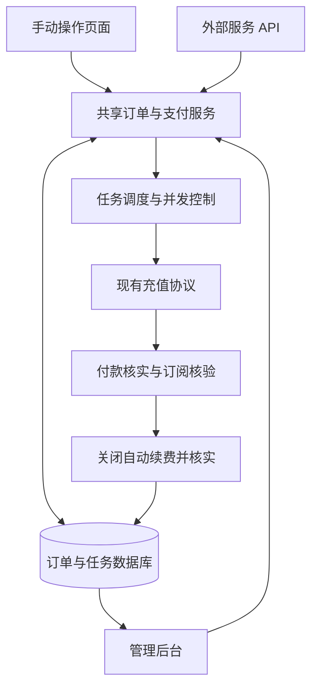

# 自动充值 API、管理后台与手动操作总体方案

| 项目 | 内容 |
|---|---|
| 项目名称 | gpt-subscribe-studio |
| 文档日期 | 2026-11-17 |
| 文档状态 | 待实施的设计方案 |
| 首版部署建议 | 单个后端实例、SQLite 持久化、后台异步任务 |
| 技术基础 | 现有 React、Mantine、FastAPI、SQLAlchemy 和充值协议实现 |

## 1. 目标与入口

在现有项目内提供手动操作页面、自动充值 API、管理后台三个入口，共用订单、支付、订阅核验和取消续费服务。

| 入口 | 使用者 | 使用方式 |
|---|---|---|
| 手动操作页面 | 人工操作人员 | 填写资料、创建账单、确认金额、点击付款、查看结果 |
| 自动充值 API | 其他服务器或独立服务程序 | 一次提交资料，后台自动推进完整充值流程 |
| 管理后台 | 管理员 | 查询全部订单、处理异常、管理密钥、队列、代理和运行配置 |

手动订单在用户点击付款后进入付款阶段。自动订单由后台按照提交参数推进。两种来源的订单统一写入数据库，并通过来源字段筛选。

## 2. 当前项目基础

当前前端已经包含开通、开通记录、代理设置、内存订单和调试模式，可以扩展为统一工作台。

当前运行的订单流程通过进程内存保存订单、展示信息和运行上下文。浏览器开通记录保存于本地存储，后台重启会释放进程内的订单记录。

项目已有 SQLAlchemy 订单、任务和支付尝试模型，以及存储和编排代码。持久化改造需要补齐当前充值流程使用的附加字段，并接入实际运行的 API。

当前本机使用 Python 3.11.9，具备 16 个逻辑 CPU，默认共享线程池为 20 个线程。建单、协议付款、Session 检测和部分核验任务共同使用这些执行位置。正式业务并发上限需要由独立调度配置和压测结果确定。

现有订单锁按订单号划分。服务化改造需要增加账号级互斥和全局业务并发控制。部分会员核验及优惠资格查询在异步函数中直接执行同步 HTTP 请求，需要接入后台执行机制。

## 3. 整体架构



HTTP 路由负责认证、参数校验和响应。共享业务服务负责订单和阶段推进。任务调度负责排队、并发、账号锁和恢复处理。数据库保存任务进度及可查询结果。

网页与新 API 调用同一套充值实现。Session 刷新、Cookie 更新、浏览器配置、代理出口、实际报价和支付结果核对沿用当前协议链路。

## 4. 手动操作模式

手动页面继续提供以下操作。

- Session 有效性检测、会员状态查询和邮箱解析。
- Go、Plus、三档 Pro 和 Team 套餐配置。
- Team 席位数、工作区名称及订阅周期配置。
- 账单地址填写及随机地址按钮。
- 卡资料一键导入。
- 协议支付和 Stripe 输入框模式。
- Stripe 支付直连选项。
- 创建账单、刷新报价、确认金额、点击付款。
- 查询支付状态、核实订阅、重试关闭自动续费。
- 展示充值邮箱、卡号后四位、开通时间和权益到期时间。

等待用户填卡、确认金额或完成银行验证的订单保存当前进度。再次提交操作时，由共享服务校验订单阶段和支付尝试记录。

手动操作记录与 API 订单统一进入管理后台。现有浏览器历史可以导入为历史快照，缺失字段标记为未知。

## 5. 自动充值流程与默认资料

### 5.1 自动执行流程

```text
校验服务密钥和参数
→ 检查外部业务单号及幂等记录
→ 创建任务并排队
→ 取得账号执行锁
→ 刷新 Session、解析邮箱、固定运行配置
→ 生成或读取账单地址
→ 创建账单并取得实际报价
→ 按实际金额和币种提交付款
→ 核实付款和目标套餐生效
→ 取消自动续费并核实
→ 保存完整结果
```

调用方提交一次资料后，由充值程序推进全部阶段。提交接口返回任务编号，调用方通过查询接口自动获取进度和结果。

### 5.2 调用方提供的资料

| 字段 | 要求与用途 |
|---|---|
| 服务密钥 | 用于机器调用身份认证 |
| 外部业务单号 | 用作幂等标识及业务关联 |
| Session | 提供完整 Session JSON，供认证刷新和账号解析使用 |
| 卡号、CVV、有效期月份和年份 | 协议付款所需资料 |
| 套餐 | 使用现有套餐标识 |
| 充值地区 | 决定购买地区及对应币种 |
| Stripe 直连选项 | 指定付款阶段的连接方式 |
| Team 附加参数 | Team 订单提供席位数、工作区名称及订阅周期 |
| 账单资料 | 可选，提供时覆盖自动生成的默认值 |

套餐标识采用 `go`、`plus`、`pro_lite`、`pro`、`pro_max`、`team`。

### 5.3 默认姓名、邮箱和地址

默认账单规则采用已经确定的设计。

1. 从有效 Session 解析并核实充值账号的邮箱。
2. 账单邮箱使用该账号邮箱。
3. 姓名取邮箱 `@` 前面的部分，例如 `alice.smith@example.com` 对应 `alice.smith`。
4. 地址采用项目现有的随机示例地址生成规则，账单国家为 `US`。
5. 每个订单生成一次地址，保存该订单的账单快照，建单、报价、付款全程复用。
6. 充值地区及币种使用调用方的请求参数。
7. 调用方提供账单资料时，使用其明确提供的字段。

当前这套随机生成器位于前端，需要将地址样本和生成规则接入后端，并保持前后端规则一致。生成结果使用随机门牌号，属于示例地址，实际金额以结账报价为准。

邮箱解析失败时，任务进入需要补充资料的状态，返回缺失字段及处理原因。

### 5.4 报价与运行配置

自动任务读取实际报价，并将金额及币种传入现有付款流程。可以支持调用方设置最高付款金额，用于判断报价是否在其授权范围内。

每个订单保存所选代理、有效 Cookie、浏览器配置、地区和账单资料的运行快照。新订单读取当前配置，后续阶段复用该订单的运行配置，并贯穿服务端收到的认证更新。

## 6. 对外 API 设计

以下接口属于拟新增的服务接口。

| 方法与路径 | 功能 |
|---|---|
| `POST /api/v1/topups` | 提交自动充值任务 |
| `GET /api/v1/topups/{id}` | 查询进度和完整结果 |
| `POST /api/v1/topups/{id}/resume` | 补充资料或完成验证后继续任务 |

### 6.1 提交示意

```http
POST /api/v1/topups
Authorization: Bearer <服务密钥>
Idempotency-Key: <外部业务单号>
Content-Type: application/json
```

```json
{
  "session": "<完整 Session JSON>",
  "plan": "plus",
  "region": "PH",
  "stripe_direct": false,
  "card": {
    "number": "<卡号>",
    "cvc": "<CVV>",
    "exp_month": "11",
    "exp_year": "2028"
  }
}
```

此请求采用自动生成的默认账单资料。需要覆盖账单资料时，可增加 `billing` 对象，其字段与现有姓名、邮箱、国家、州省、城市、街道和邮编表单对应。

提交成功返回 HTTP `202`。响应结构示意如下。

```json
{
  "order_id": "<内部订单编号>",
  "status": "queued",
  "status_url": "/api/v1/topups/<内部订单编号>"
}
```

### 6.2 查询结果

查询响应包含以下信息。

- 内部订单编号、外部业务单号、任务来源、当前阶段和状态。
- 充值邮箱、卡号后四位、套餐、充值地区。
- 实际金额、币种及付款确认结果。
- 订阅是否生效、实际套餐、开通时间、权益截止时间。
- 自动续费状态、取消结果及核验时间。
- 可继续执行的操作、需要补充的资料及脱敏错误信息。

### 6.3 继续任务

`resume` 用于补充 Session 等资料，或者在持卡人完成验证后继续核验。

补充 Session 时核对账号归属。已经提交付款的任务先查询原交易，再根据付款、订阅及续费结果推进后续阶段。

### 6.4 认证与错误响应

机器接口使用独立服务密钥，管理后台和手动页面使用管理员登录会话。服务密钥的权限范围覆盖其所属任务。

| HTTP 状态 | 典型用途 |
|---|---|
| `202` | 新任务已受理 |
| `200` | 查询、继续任务或返回已有任务结果 |
| `401` | 服务密钥无效或失效 |
| `403` | 请求超出密钥权限范围 |
| `409` | 相同业务单号对应的关键参数发生冲突 |
| `422` | 提交资料缺失或格式错误 |
| `429` | 调用频率或队列容量达到配置限制 |
| `503` | 当前暂停接收新任务或服务暂不可用 |

错误响应提供稳定错误码、可读说明和任务编号，便于调用方决定查询、补交资料或稍后重试。

## 7. 管理后台功能

### 7.1 运行概览

显示排队数、执行数、成功数、失败数、待核实数，以及按套餐、地区和订单来源统计的数据。付款金额按币种分别汇总。

### 7.2 订单列表与详情

订单列表统一展示手动订单和 API 订单，支持按外部业务单号、邮箱、卡号后四位、套餐、地区、来源、状态及时间筛选。

详情页展示以下内容。

- 当前阶段和执行时间线。
- 实际报价、付款金额和币种。
- 付款、订阅、自动续费三个独立结果。
- 开通时间、权益截止时间。
- 代理及运行配置摘要。
- 交易标识、错误说明和请求追踪编号。

管理员可发起付款结果查询、订阅核验、关闭续费重试，以及同一账号新 Session 的补充操作。

### 7.3 任务与队列

- 查看排队、执行中、需要资料和需要验证的任务。
- 配置业务并发上限和队列容量。
- 暂停接收新任务及恢复接单。
- 取消尚未进入付款阶段的排队任务。
- 查看任务占锁、执行时间和重试记录。
- 清理过期运行上下文。

调整并发上限作用于后续调度，正在执行的交易继续完成结果核实。

### 7.4 API 密钥管理

管理员可以创建、停用和轮换服务密钥，配置调用权限及频率限制，并查看关联任务、最近使用时间和调用记录。

密钥明文在创建时展示一次，数据库保存用于校验的摘要。查询和任务操作按调用服务归属校验。

### 7.5 代理和运行配置

管理代理启停、连接检测、默认付款线路和任务并发参数。后台展示配置摘要，认证信息通过受控的设置操作更新。

### 7.6 日志与调试

按订单检索阶段日志、脱敏请求响应、错误和执行耗时。日志关联订单编号及请求追踪编号。

统一脱敏覆盖入口、转发和响应链路，处理服务密钥、Session、Cookie、完整卡号、CVV 和代理认证信息。现有调试及 HAR 导出功能需要接入这一处理链路。

### 7.7 实时状态

页面通过现有 SSE 能力接收状态变化。连接重建后读取数据库中的最新快照，再继续接收更新。

## 8. 状态与完整成功标准

任务执行状态、付款结果、订阅结果和续费结果分别保存。

| 任务状态 | 含义 |
|---|---|
| `queued` | 排队等待执行位置 |
| `running` | 正在执行建单、报价或付款阶段 |
| `requires_input` | 需要补充或更新 Session 等资料 |
| `requires_action` | 等待持卡人完成银行验证 |
| `unknown` | 付款已提交，交易结果待核实 |
| `verifying` | 付款已确认，正在核实订阅和续费 |
| `succeeded` | 付款确认、目标套餐生效、自动续费关闭均已核实 |
| `failed` | 已取得明确失败结果 |
| `cancelled` | 尚未进入付款阶段的任务已取消 |

完整成功采用三个条件。

1. 付款已确认。
2. 目标套餐已生效。
3. 自动续费已关闭并完成核实。

付款确认后遇到认证失效或核验异常，保留已确认的付款结果，并提供补充资料或继续核验的操作。支付结果不确定时，先查询原交易。

银行要求持卡人交互时，任务进入 `requires_action`，返回验证入口，完成验证后继续核验。

开通时间采用订阅响应中的实际开通字段。到期时间优先采用已经确定的 `entitlement.expires_at`，兼容现有订阅响应的到期字段。缺失时间显示“待获取”。数据库保存 UTC，API 使用带时区的 ISO 8601，页面统一显示北京时间（UTC+8）。

## 9. 持久化与重启恢复

### 9.1 订单记录

扩展现有订单模型，保存以下信息。

- 订单来源、调用服务、外部业务单号及幂等记录。
- 账号身份标识、充值邮箱、卡号后四位。
- 套餐、充值地区、实际金额及币种。
- 账单快照、付款线路及运行配置摘要。
- 订单阶段、任务状态、付款、订阅和续费结果。
- 上游交易标识、脱敏错误及追踪编号。
- 创建、更新、付款确认、订阅开通、权益截止及续费取消时间。

### 9.2 任务和支付尝试

任务记录保存阶段、重试次数、调度时间、占锁信息及错误。支付尝试记录保存交易标识、实际金额、币种及核实结果。

订单创建、幂等约束和首个任务写入采用数据库事务。任务领取及状态推进增加占锁和一致性校验。

### 9.3 敏感资料生命周期

Session、完整卡号和 CVV 采用任务内存保存。数据库保存业务进度、交易关联信息及卡号后四位。

排队和执行期间检查敏感资料的有效期，资料过期时进入 `requires_input`。

### 9.4 重启后的处理

| 重启前进度 | 恢复处理 |
|---|---|
| 排队或尚未提交付款 | 保留订单记录，要求调用方补交付款资料后继续 |
| 已提交付款，结果不确定 | 按原交易标识查询结果，所需账号资料缺失时提示补交 |
| 付款已确认，订阅或续费待核实 | 保留付款确认结果，取得有效 Session 后继续核验 |
| 已完成 | 直接提供持久化结果查询 |

现有内存订单迁移为历史快照。部署切换前等待正在执行的任务完成，保存现有记录，再加载新版本。浏览器历史导入时标注数据来源，缺失字段保持未知。

## 10. 并发、幂等与任务控制

### 10.1 全局并发

手动任务和 API 任务共同进入业务并发控制。执行位置和等待队列具有显式容量配置。

等待用户填卡、确认金额、补充资料或完成银行验证时保存阶段并释放执行位置。收到继续操作后重新进入调度。

### 10.2 账号级互斥

按已经核实的 ChatGPT 账号身份控制同一账号的任务执行。现有按订单号保护支付过程的锁继续参与阶段互斥。

### 10.3 幂等处理

按调用服务与外部业务单号建立唯一约束，并记录关键业务参数摘要。

- 相同业务单重复提交时复用原任务。
- 关键参数冲突时返回 `409`。
- 调用方超时后可使用原业务单号查询或重试提交。
- 付款结果不确定时执行查询和核验。
- 补充认证资料时校验账号归属和原任务阶段。

### 10.4 重试范围

建单、订阅查询和续费核验根据现有协议的可恢复条件执行有限重试。付款提交及其重试由支付尝试记录、现有协议上下文和交易核实结果共同约束。

## 11. 部署与访问

首版建议使用单个后端实例和 SQLite，外部调用方可以部署在其他服务器。前端、手动入口和管理后台继续由当前项目提供。

远程服务通过可达的 HTTPS 入口访问，由反向代理转发到后端。管理员页面使用登录会话，服务 API 使用独立密钥。运行数据和数据库需要纳入备份及恢复流程。

单机配置涵盖业务并发、队列容量、任务超时、资料有效期、重试间隔、代理和付款线路。具体并发默认值通过模拟压测和上线验收确定。

## 12. 实施顺序

| 阶段 | 交付内容 |
|---|---|
| 第一阶段 | 提取共享订单与支付服务，完善数据库字段和连接生命周期，接入持久化，迁移现有记录，完成手动流程回归 |
| 第二阶段 | 实现服务密钥、自动充值接口、默认账单资料、幂等、并发控制和后台任务调度 |
| 第三阶段 | 增加运行概览、订单详情、队列、密钥、代理配置和日志管理页面 |
| 第四阶段 | 完成异常处理、超时、重复提交、并发、重启恢复、银行验证及真实充值流程验收 |

## 13. 验收要求

### 13.1 手动操作

- 六个套餐标识均可通过现有手动入口配置和执行。
- 协议支付、Stripe 输入框、卡资料导入、随机地址和直连选项可用。
- 人工确认金额和点击付款的步骤可正常使用。
- 订单摘要显示邮箱、开通时间和权益截止时间，时间按北京时间展示。

### 13.2 自动接口

- 一次提交资料后，后台可以推进完整任务。
- 默认姓名采用邮箱前缀，账单邮箱采用充值邮箱，地址在订单全过程中保持一致。
- 同一服务的相同外部业务单号对应同一任务。
- 不同服务的订单访问遵循其权限范围。
- 查询结果包含付款、订阅和续费三个独立结果。

### 13.3 并发与异常

- 不同账号的任务可以按配置并行推进。
- 同一账号的任务遵循账号级互斥。
- 达到业务并发上限后，后续任务进入等待队列。
- 页面关闭或调用方请求超时后，后台任务继续推进，结果可以查询。
- 已提交付款的重复请求和结果查询复用原支付尝试。
- Session 失效、银行验证、代理超时、报价变化及核验失败均有明确反馈。

### 13.4 数据与运行

- 后台重启后可以查询持久化订单和已有付款结果。
- 资料缺失的恢复任务提供补交入口。
- 现有记录迁移后保留已知字段及来源。
- 日志、管理页面和 HAR 导出符合统一脱敏规则。
- 在模拟支付回归通过后完成真实流程验收，并据此确定运行并发配置。
