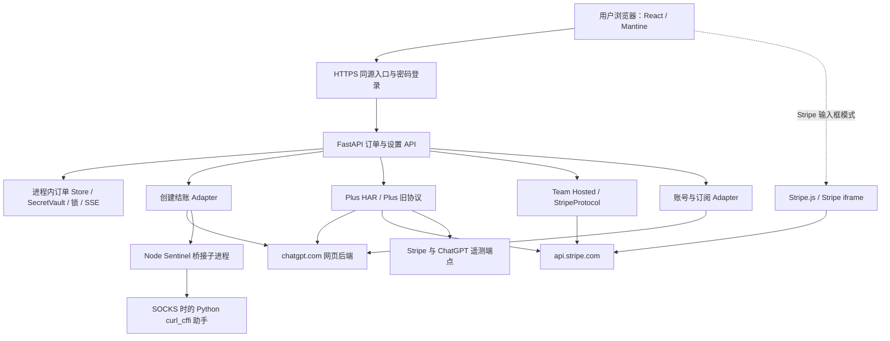
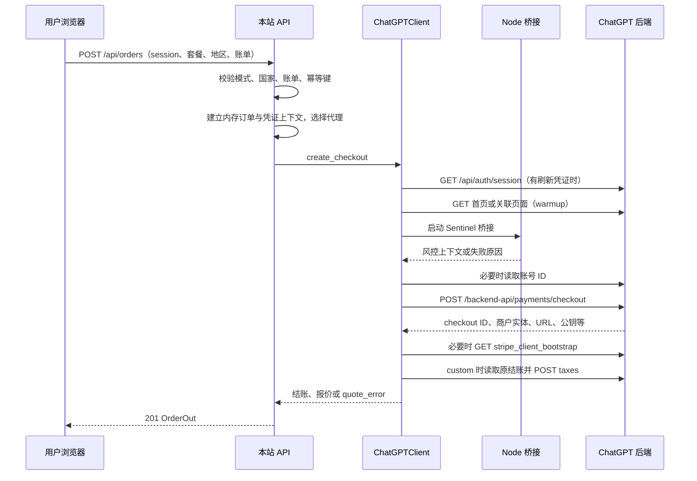
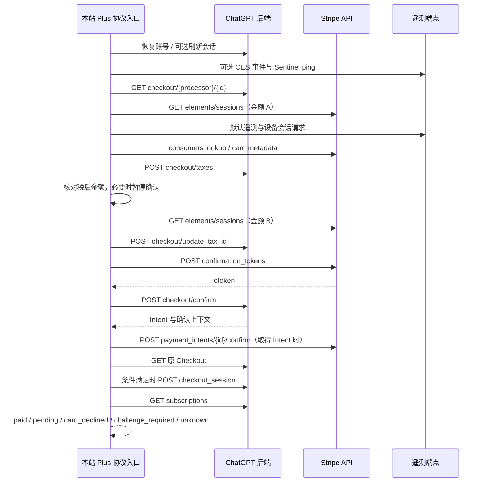
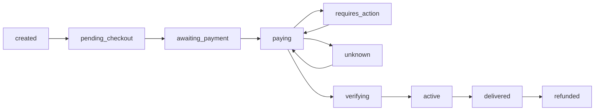

# 项目源码分析与支付请求详解

分析日期：2026-11-05。

对应版本：`1cf47fb8cb18114a618734ef15f0e8f7c2fc5249`，分支 `fix/manual-billing-proxy-runtime`。

分析对象：[hdd99009/gpt-subscribe-studio-1](https://github.com/hdd99009/gpt-subscribe-studio-1/tree/1cf47fb8cb18114a618734ef15f0e8f7c2fc5249)。这是当前本机运行版本的源码分析，包含相对于原项目新增的手动账单、代理兼容及超时处理。

本文按源码说明程序实际如何工作，不把 README 中的描述直接当作实现事实。请求路径和参数来自代码；它们不表示上游平台承诺长期支持这些接口，也不表示所有套餐均已实测支付成功。本次分析没有发送绑卡、付款确认或创建结账请求。脱敏检查只用了虚构的标记字符串。

示例中的 `<SESSION>`、`<真实账单地址>`、`<CARD_NUMBER>`、`<CLIENT_SECRET>` 都是占位符，不是可直接运行的付款请求。风控模块说明限于依赖、调用边界、网络请求和故障处理，不展开令牌计算或验证码求解方法。

## 阅读目录

1. [项目到底做了什么](#1-项目到底做了什么)
2. [技术结构与运行组件](#2-技术结构与运行组件)
3. [界面按钮与真实代码路径](#3-界面按钮与真实代码路径)
4. [关键对象和标识符](#4-关键对象和标识符)
5. [Session 与资格检测](#5-session-与资格检测)
6. [创建结账的完整过程](#6-创建结账的完整过程)
7. [Plus 默认支付协议逐请求说明](#7-plus-默认支付协议逐请求说明)
8. [Plus 浏览器输入框与旧协议](#8-plus-浏览器输入框与旧协议)
9. [Team Hosted 支付协议](#9-team-hosted-支付协议)
10. [保存卡片功能](#10-保存卡片功能)
11. [全部业务 API](#11-全部业务-api)
12. [外部请求总表](#12-外部请求总表)
13. [金额、账单地址和税费](#13-金额账单地址和税费)
14. [代理如何使用](#14-代理如何使用)
15. [Sentinel、超时和进程管理](#15-sentinel超时和进程管理)
16. [数据保存与敏感信息流向](#16-数据保存与敏感信息流向)
17. [订单状态、交付与重复付款防护](#17-订单状态交付与重复付款防护)
18. [部署、配置与日志](#18-部署配置与日志)
19. [代码中实际存在的问题](#19-代码中实际存在的问题)
20. [测试覆盖与阅读源码顺序](#20-测试覆盖与阅读源码顺序)
21. [源码索引](#21-源码索引)

## 1. 项目到底做了什么

这是一个自托管的 ChatGPT 订阅结账客户端。使用者把自己的 ChatGPT 会话交给它，由它代表当前账号访问 ChatGPT 网页后端，创建订阅结账，再对接 Stripe 的支付相关接口。

它的工作可以拆成七件事：

| 工作 | 程序实际做的事情 | 是否已经付款 |
| --- | --- | --- |
| 接收账号会话 | 解析粘贴的 access token 或 session JSON，必要时刷新会话 | 否 |
| 检测资格 | 请求账号检查接口，读取当前套餐、是否免费账号和可见活动 | 否 |
| 创建结账 | 选择套餐、地区、币种、Team 席位等，取得结账会话 | 否 |
| 获取报价 | 读取结账信息，提交账单地址核算税费 | 否 |
| 准备支付方式 | 向 Stripe 提交卡信息或复用浏览器取得的支付方式标识 | 还不能据此认定已付订阅款 |
| 确认支付 | 确认 ChatGPT 结账以及 Stripe Intent，或确认 Hosted Checkout | 这是金融状态可能发生变化的阶段 |
| 查询结果 | 读取 Stripe 状态、原结账和订阅权益，更新本地显示 | 查询本身不等于再次付款 |

源码没有实现本站独立的商户收单开户或资金中转账本。`pk_` 公钥、结账会话和 Intent 来自相应的上游商户集成，项目使用这些上下文对接上游支付。

核心业务入口是网页和 HTTP API。仓库还保留批量脚本、旧支付实现、抓包研究记录、验证码研究工具和 worker 雏形；这些文件的存在不代表它们都参与当前网页流程。

“协议支付”的含义是：主要由服务端代码构造 HTTP 请求推进支付，而不是在服务器启动浏览器操作官方结账页面。浏览器 Stripe 输入框模式则仍会加载 Stripe.js，并由用户浏览器与 Stripe 交互。

源码依据：[应用组装][S01]、[网页入口][S02]、[订单路由][S03]。

## 2. 技术结构与运行组件

### 2.1 总体结构



### 2.2 目录与职责

| 目录 | 技术 | 职责 |
| --- | --- | --- |
| `apps/web` | React 19、TypeScript、Vite、Mantine | 新建订单、输入会话与账单、填卡、查看结果、代理设置、浏览器历史 |
| `packages/contracts` | Python 数据类、枚举、协议接口 | 套餐、模式、订单状态、支付状态、Adapter 输入输出、领域错误 |
| `packages/core` | Python、curl_cffi、httpx、Node.js | ChatGPT 客户端、Stripe 协议、报价、代理、临时凭证、Sentinel 运行桥接 |
| `services/api` | FastAPI、Pydantic | HTTP 路由、参数检查、订单视图、锁、SSE、运行时组装 |
| `services/checkout` | Python Adapter | 生成结账、代理预检、上游会话刷新、返回报价 |
| `services/payment` | Python Adapter | 通用 `/pay` 入口使用的确认支付和结果解析 |
| `services/account` | Python Adapter | 查询优惠资格、查询账号订阅 |
| `services/orchestrator` | Python | 流水线抽象，以及尚未接入网页主流程的 worker |
| `deploy/server` | Uvicorn / ASGI | 密码登录中间件、API 与前端静态文件的同源入口 |
| `deploy/local` | PowerShell、Python、Docker、Caddy | 本机初始化、证书、Windows 运行与可选容器部署 |
| `tests` | pytest、Node 测试 | 订单 API、协议请求构造、状态判断、敏感信息脱敏、代理和超时测试 |
| `scripts` | Python / JavaScript | 独立探测与批处理入口；需逐个看用途，不能当成网页全部功能 |
| `tools`、`attic` | 独立工具与归档 | 研究用求解器、浏览器路径、历史实现，不是默认启动服务 |

### 2.3 是单体进程，还是微服务

代码按 `services/*` 拆目录，但当前网页部署并没有启动 checkout、payment、account 三个独立网络服务。

`build_pipeline()` 直接在 API 进程中实例化三个 Adapter。路由通过 Python 方法调用它们；同步网络操作在部分路径用 `asyncio.to_thread()` 放进线程运行。Node 是按需启动的子进程，SOCKS 传输又可能由 Node 启动一个 Python 助手。

因此当前形态更接近“按模块组织的单体应用”。目录边界不等于独立服务边界。

### 2.4 真实模式与 Fake 模式

`GSS_USE_FAKE=true` 时组装 Fake Adapter，适合离线演示和测试。默认不设置该变量时，走项目自己的真实 ChatGPT / Stripe 客户端。

当前本机配置检查结果：`GSS_USE_FAKE=false`、`GSS_ENABLE_PROMO=false`、`GSS_PLUS_ENGINE=har`。这只是配置状态，不是支付成功证明。

源码依据：[运行时组装][S04]、[流水线][S05]、[配置][S06]。

## 3. 界面按钮与真实代码路径

理解本项目最重要的一点：界面上看似同一个“支付”，后端实际上可能走不同实现。

### 3.1 当前网页的分流

| 用户操作 / 订单类型 | 前端组件与接口 | 实际后端路径 |
| --- | --- | --- |
| 检测资格 | `OrderNew` → `checkPromoEligibility` | `/api/promo/eligibility` → 账号 Adapter |
| 创建结账 | `OrderNew` → `createOrder` | `/api/orders` → Checkout Adapter → `ChatGPTClient.create_checkout` |
| Plus + 默认服务端填卡 | `PlusProtocolPayPanel` | `/bind-and-pay-protocol` → `run_checkout_protocol` → 通常为 `run_har_context` |
| Plus + Stripe 输入框 | `LegacyProtocolPayPanel` 的 `browserPayment` 分支 | 浏览器取得 `pm_` → `/pay` → Payment Adapter |
| Team + 服务端填卡 | `LegacyProtocolPayPanel` | `/pay-protocol` → `StripeProtocol` |
| Team + 浏览器取得支付方式 | `LegacyProtocolPayPanel` | `/pay-protocol` 复用 `payment_method_id` → `StripeProtocol` |
| 其他个人套餐 | 通用协议面板 | `/pay-protocol`，按 custom / hosted 与输入方式选择引擎 |
| Plus 刷新报价 | `refreshCheckoutQuote` | `/orders/{id}/quote`，复用原结账，不创建新订单 |
| Team 初始报价 / 刷新报价 | `quoteTeam` | `/team/quote` → `TeamHostedClient.quote` |

`OrderNew` 把 `payMode` 固定为 `protocol`。其中还留有 `team/prepare + pay` 的表单提交代码，但当前支付步骤主要由 `ProtocolPayPanel` 自带按钮提交。不能因为文件中出现一个函数，就认为用户每次点击都会执行它。

### 3.2 两种“Plus 旧路径”不要混为一谈

1. `checkout_protocol.py` 是 `/bind-and-pay-protocol` 下的旧直付实现。是否走 HAR，受 `har_engine_enabled()` 与 checkout ID 类型共同影响。
2. `plus_protocol.py` 的 `PlusProtocol` 是另一个支付类，用在 `/pay-protocol` 的混合模式 / 部分兼容分支。

`GSS_PLUS_ENGINE=legacy` 不是全项目所有支付入口的统一开关。`/pay-protocol` 路由中有直接构造 `PlusHarProtocol` 的分支，没有经过这个环境开关判断。

### 3.3 套餐支持的准确含义

枚举中包含 `plus`、`go`、`pro_lite`、`pro`、`pro_max`、`team`，并提供相应的建单映射。但是默认 Plus 面板、保存卡片路由、订阅成功判断里有多处明确针对 Plus 的逻辑。

因此应区分：

- 能选择套餐并构造创建结账参数；
- 某个支付引擎能接受该套餐；
- 该套餐所有返回结构都处理完整；
- 已经用真实上游完成端到端验证。

本源码不能证明这四件事对全部套餐都成立。例如 HAR 的 `_subscription_active()` 明确检查 Plus 权益，不能直接视为 Go / Pro 的通用成功判据。

源码依据：[网页分流][S02]、[前端 API][S07]、[协议路由][S08]、[引擎分发][S09]。

## 4. 关键对象和标识符

| 名称 | 来自哪里 | 用来做什么 | 不能据此得出的结论 |
| --- | --- | --- | --- |
| 本站订单 UUID | `/api/orders` | 把界面、内存凭证、状态与锁关联起来 | 不是 Stripe 订单号 |
| access token | 用户提供的 ChatGPT session | `Authorization: Bearer …` 访问账号接口 | 有格式不表示当前仍有效 |
| session token | ChatGPT 登录 Cookie | 请求 `/api/auth/session` 换取 / 刷新 access token | 不等于支付令牌 |
| account ID | JWT 或账号接口 | 指定正在操作的 ChatGPT 账号 / 工作区 | 不是 Stripe Customer |
| `oaics_…` | ChatGPT 创建结账返回 | ChatGPT 内部 custom checkout 的会话标识 | 不是 `cs_` Hosted 会话 |
| `cs_live_…` / `cs_test_…` | Stripe / 上游创建结账 | Stripe Checkout 会话 | 单看前缀还不能区分本项目的 hosted / custom 分支 |
| `processor_entity` | ChatGPT 结账上下文 | 路由到相应商户实体的结账信息 | 不由用户账单州直接决定 |
| `pk_live_…` / `pk_test_…` | 结账响应或 bootstrap | Stripe 发布公钥，用于客户端侧支付流程 | 不是商户 secret key，也不是付款成功凭据 |
| `cuss_…` 类客户会话 secret | 上游结账 / Elements | 带入 Stripe 客户上下文 | 是敏感上下文，不能当普通日志公开 |
| `pm_…` | Stripe PaymentMethod 接口或 Stripe.js | 一个支付方式的引用 | 不等于订阅款已扣成功 |
| `ctoken_…` | Stripe confirmation token 接口 | 将支付方式与这次确认上下文关联 | 不等于 Intent 已确认成功 |
| `pi_…` | Stripe PaymentIntent | 某次收款的状态机 | HTTP 200 或存在 pi ID 不等于已收款 |
| `seti_…` | Stripe SetupIntent | 支付方式验证、保存流程 | 不等于订阅付款完成；验证也可能涉及发卡行验证或临时授权 |
| `*_secret_*` | 对应 Intent 响应 | 客户端操作 / 查询该 Intent | 应作为敏感数据处理 |
| `cus_…` | Stripe 客户上下文 | 将保存的支付方式关联至客户 | 与 ChatGPT account ID 是不同体系 |
| guid / muid / sid | Stripe 设备上下文 | 关联设备与会话 | 这些 sid 不等于住宅代理用户名中的 SID |
| Sentinel token | Node 桥接得到 | ChatGPT 风控相关请求头 | 不是支付授权结果 |

Stripe 官方把 ConfirmationToken 定义为把客户端收集的数据交给服务端确认 Intent 的对象，把 SetupIntent 用于准备后续支付方式；PaymentIntent 则有独立的收款生命周期。因此这些标识不能相互替代，也不能将“已保存支付方式”理解成“本次订阅款已经支付”。参见 [ConfirmationToken 文档](https://docs.stripe.com/api/confirmation_tokens)、[SetupIntent 文档](https://docs.stripe.com/payments/setup-intents)和 [Intent 生命周期](https://docs.stripe.com/payments/paymentintents/lifecycle)。这只核对公共对象语义，不代表该项目的网页私有接口是 Stripe 推荐的公开商户接入方式。

## 5. Session 与资格检测

### 5.1 Session 输入支持哪些形式

`parse_session_bundle()` 可处理：

- 带或不带 `Bearer` 前缀的 access token 文本；
- 包含 `accessToken`、`access_token` 等字段的 JSON；
- 嵌套在 `session` 或 `user` 下的部分结构；
- Cookie 列表 / 字典里携带的 session token、设备 ID；
- 五段 JWE 形式的 session token，按 session cookie 对待。

但它不是完整的 token 验证器。解析格式成功只表示程序提取出了字符串，真正是否有权限仍取决于上游响应。JSON 解析路径没有找到 access token 时会报错；只有某些纯文本 session token 形式会进入自动换取 access token 的建单分支。

源码依据：[Session 解析][S10]。

### 5.2 session token 刷新请求

```text
GET https://chatgpt.com/api/auth/session
```

用途：通过同一出口、已有会话 Cookie 读取新的 access token 和关联 Cookie。

触发位置包括：

1. 创建订单时只有 session token、没有 access token；
2. Checkout Adapter 创建结账前的刷新；
3. 支付前恢复账号 / 刷新会话的部分路径。

第一种情况下，换取失败会阻止继续建单。已经具有 access token 的部分路径把刷新视为软失败：记录警告后继续沿用原凭证。

当前 Checkout Adapter 的客户端超时是 120 秒。这与 Sentinel 自身的 90 秒外层总上限是不同的计时器；一次建单总等待时间可能超过 90 秒。

### 5.3 账号 ID 如何确定

首先尝试从 access token 的 JWT 载荷提取账号 ID。拿不到时，`hydrate()` 请求：

```text
GET https://chatgpt.com/backend-api/me
```

必要时回退：

```text
GET https://chatgpt.com/backend-api/accounts/check/v4-2023-04-27
    ?timezone_offset_min=0
```

这里 JWT 载荷读取属于提取信息，不是本站完成 JWT 签名验证。上游 API 返回仍是实际授权依据。

### 5.4 “检测资格”到底检测什么

前端发给本站：

```text
POST /api/promo/eligibility
Content-Type: application/json

{ "session": "<SESSION>" }
```

后端通过账号 Adapter 查询上述 accounts/check 接口，再从响应提取：

| 返回字段 | 含义 |
| --- | --- |
| `account_id` | 当前解析到的账号 |
| `current_plan_type` / `subscription_plan` | 账号当前套餐描述 |
| `is_free` | 解析结果是否属于免费账号 |
| `plus_eligible` | 程序根据上游数据归纳的 Plus 可用性 |
| `campaigns` | 活动 ID、折扣百分比、期限与展示文案 |

这个请求没有创建 Checkout，也没有调用 Stripe 确认付款。它不验证银行卡是否会获批，也不能证明未来报价、税额或地区请求一定成功。

源码依据：[ChatGPT 账号与资格接口][S11]、[资格路由][S12]。

## 6. 创建结账的完整过程

### 6.1 前端提交给本站的内容

```json
{
  "plan": "plus",
  "billing_country": "<所选结账地区>",
  "session": "<SESSION>",
  "billing": {
    "name": "<真实持卡人姓名>",
    "email": "<账单邮箱>",
    "line1": "<真实街道地址>",
    "city": "<城市>",
    "state": "<州或省>",
    "postal_code": "<邮编>",
    "country": "<真实账单国家>"
  },
  "mode": {
    "account_source": "customer_session",
    "card_source": "customer",
    "billing_mode": "standard",
    "risk_acknowledged": false
  }
}
```

请求是 `POST /api/orders`，前端还会生成 `Idempotency-Key`。

Team 另有 `workspace_name`、`seat_quantity`、`price_interval` 和可选 `promo_code`。Team 最少 2 席；`month/year` 被归一化处理。

当前网页只对 Plus 在创建结账前强制填写手动账单。后端 schema 的 `billing` 仍是可选项，所以不能把“网页要求填写”理解成“所有 API 调用都强制提供”。

### 6.2 服务器按什么顺序处理



### 6.3 本站先做的检查

检查内容包括套餐枚举、模式组合、促销开关、session、支持国家，以及传入账单时的完整性。US / CA 地址要求州或省。

然后选择本单代理，创建内存订单与 Job，将会话放入 SecretVault。成功后保存上游 checkout ID、公钥、报价、账单、结账类型及最终有效代理。

### 6.4 发给 ChatGPT 的创建请求

```text
POST https://chatgpt.com/backend-api/payments/checkout
Content-Type: application/json
```

个人套餐的主要 JSON 字段：

| 字段 | 来源 / 作用 |
| --- | --- |
| `plan_name` | 按套餐映射，如 Plus 对应 `chatgptplusplan` |
| `entry_point` | 代码固定的个人套餐定价入口标识 |
| `billing_details.country` | 用户选择的结账地区 |
| `billing_details.currency` | 根据该地区映射出来的币种 |
| `checkout_source` | 代码使用的网页结账来源标识 |
| `supports_saved_payment_link` | 声明支付链接相关能力 |
| `checkout_appearance` | 页面外观偏好 |
| `cancel_url` | 取消后返回 ChatGPT 的地址 |
| `purchase_attempt_id` | 每次生成的尝试 UUID |
| `checkout_ui_mode` | 个人套餐为 `custom` |
| `promo_campaign` | 有活动时才附加，包含活动 ID 等信息 |

Team 改为 `plan_name=chatgptteamplan`、`checkout_ui_mode=redirect`，并包含：

```json
{
  "team_plan_data": {
    "workspace_name": "<工作空间名>",
    "price_interval": "month",
    "seat_quantity": 5
  }
}
```

**手动账单的完整街道地址，并没有作为新增字段塞入这个 create 请求。** 当前改动是本站创建流程接收并保留真实账单，在上游 Checkout 已生成后，再向 taxes 接口提交完整地址核算报价。

### 6.5 响应怎么解析

代码接受多个候选字段来提取 URL、checkout ID、公钥。个人 custom 分支优先识别 `oaics_` 内部 ID；可能同时出现 `cs_` 和 `oaics_`。Team 需要得到可信的 Hosted 长链接。

缺少公钥时尝试：

```text
GET https://chatgpt.com/backend-api/payments/stripe_client_bootstrap
    ?account_id=<ACCOUNT_ID>
```

Team 取得长链但拿不到公钥时，有降级为手动打开链接的能力。custom 分支通常需要公钥，缺失会报错。

### 6.6 创建后如何报价

custom 分支先读取结账详情，再提交 taxes。详情查询可能依次尝试不同 processor 路径，以及不带 processor 的兼容路径，因此不一定只发一次 GET。

如果上游 Checkout 已创建，但传入手动账单后的报价暂时没拿到，当前代码保留 Checkout，并返回：

- `amount=null`；
- `quote_error`；
- 可继续展示的结账上下文。

前端在没有报价时禁用提交付款，提供刷新报价入口。这与“建单完全失败”不同。

源码依据：[订单创建路由][S03]、[Checkout Adapter][S13]、[创建请求构造][S14]、[创建结账与报价][S15]。

## 7. Plus 默认支付协议逐请求说明

本节对应当前网页 **Plus + 服务端填卡 + `oaics_` Checkout + HAR 引擎** 的主要路径。

`bind-and-pay-protocol` 的命名保留了历史痕迹。当前默认这条路径并不是“先创建 SetupIntent 绑定卡，再重新创建结账”。它使用已有 Checkout，直接创建 confirmation token 并确认支付。

### 7.1 本站收到的支付请求

```text
POST /api/orders/<ORDER_ID>/bind-and-pay-protocol
```

```json
{
  "card": {
    "number": "<CARD_NUMBER>",
    "cvc": "<CVC>",
    "exp_month": "<MM>",
    "exp_year": "<YYYY>"
  },
  "billing": {
    "name": "<真实姓名>",
    "email": "<邮箱>",
    "line1": "<真实地址>",
    "city": "<城市>",
    "state": "<州或省>",
    "postal_code": "<邮编>",
    "country": "<国家代码>"
  },
  "expected_amount": "<用户确认的金额>",
  "expected_currency": "<币种>"
}
```

服务器先比对金额与币种。随后用仅保存在内存的随机密钥，对卡片与账单请求计算 HMAC 摘要，用于识别同一订单是否被换了一份支付资料。这里保存的是摘要，不是为了再次取回卡号。

源码依据：[Plus 协议路由及锁][S16]。

### 7.2 总时序



这里的遥测不是固定只发一两次。事件按阶段批量发送，资产预热、设备注册、心跳和条件分支会改变请求数量。

### 7.3 第 0 步：恢复同一账号与请求上下文

`run_har_context()` 先恢复账号并检查是否与订单绑定的 account ID 一致，然后把原结账 ID、URL、公钥、币种、账单、代理和已有 Intent 上下文交给 HAR 引擎。

设备资料在存在 account ID 时可由 `device_for_account()` 持久化复用；某次尝试的部分标识会更新。代码注释和界面上“每次全部随机”的表述并不覆盖所有实际路径。

这里还会调用 Sentinel 相关流程。**创建结账时取不到 Sentinel 会直接失败；HAR 支付类的 `_sentinel()` 却捕获异常、记录警告后返回。** 两个阶段对失败的处理不同，不能把它们描述成统一的强制门槛。

### 7.4 第 1 步：读取已有结账

```text
GET https://chatgpt.com/backend-api/payments/checkout/<PROCESSOR>/<CHECKOUT_ID>
    ?supports_business_seat_offer=true
```

主要读取：

- `status`、`payment_status`；
- `publishable_key`；
- `customer_session_client_secret`；
- `confirm_return_url`；
- `checkout_state.total.total.minorUnitsAmount`。

HAR 引擎对最终总额结构要求较明确，必须能取得整型最小货币单位金额；不是拿一个本地挂牌价直接当作应付款。

如果原结账已经完成，代码进入结果核验，不应再走一遍新卡准备和付款确认。

### 7.5 第 2 步：第一次 Elements Session

```text
GET https://api.stripe.com/v1/elements/sessions
```

关键查询参数分组：

| 参数 | 作用 |
| --- | --- |
| `type=deferred_intent` | 延迟创建 Intent 的 Elements 上下文 |
| `deferred_intent[mode]=subscription` | 订阅模式 |
| `deferred_intent[amount]` | 当前税费同步前的金额 A，最小货币单位 |
| `deferred_intent[currency]` / `currency` | 小写币种 |
| `deferred_intent[payment_method_types][…]` | 本实现声明的 card、link 等类型 |
| `deferred_intent[setup_future_usage]` | 保存支付方式的使用上下文 |
| `customer_session_client_secret` | 有该上下文时附带 |
| `key` | 上游公钥 |
| `_stripe_version` | 代码指定的版本 |
| `locale` / `browser_timezone` | 语言和时区 |
| `stripe_js_id`、集成来源字段 | 关联本次 Elements 客户端会话 |

响应中提取 Elements session ID、config ID、Customer，以及上游可能提供的验证配置。

Customer 的实际结构可能是嵌套对象，代码专门处理 `customer.customer_session.customer` 这一类响应形态。

### 7.6 第 3 步：遥测与辅助请求

默认 `GSS_HAR_TELEMETRY` 是 `full`，当前本机没有覆盖该默认值。

此阶段涉及：

| 请求 | 源码中的用途 | 失败处理 |
| --- | --- | --- |
| `POST https://chatgpt.com/ces/v1/rgstr` | 发送客户端事件 | 通常捕获异常继续 |
| `POST https://chatgpt.com/backend-api/sentinel/ping` | 相关流程的心跳 | 捕获异常继续 |
| `GET https://js.stripe.com/...` | 预热 SDK / iframe 资源 | 多数为软失败 |
| `GET https://m.stripe.network/...` | 预热设备相关资源 | 多数为软失败 |
| `POST https://m.stripe.com/6` | 设备 / 会话信息注册与后续心跳 | 按遥测类处理 |
| `POST https://r.stripe.com/b` | 分阶段提交 SDK 事件批次 | 多数为软失败 |

这里涉及客户端上下文的构造与遥测重放，并不意味着后台真的运行了 Chrome。服务器构造的事件也不能证明支付平台一定接受或信任这些信号。

源码依据：[HAR 主流程][S17]、[遥测模块][S18]、[设备持久化][S19]。

### 7.7 第 4 步：Link / Consumer 查询与卡元数据

```text
POST https://api.stripe.com/v1/consumers/sessions/lookup
```

HAR 路径有三个调用位置，对应不同 `request_surface`：payment element、Link authentication、Elements controller。README 简图写“×2”，实际 `pay()` 有三次调用。

主要字段是 `email_address`、`email_source`、`session_id`、`key`，部分 surface 会附带 recurring / Link 能力和 Customer 上下文。它用于查询 Stripe Link / consumer 关联信息，不是扣款请求。

输入卡号至少六位时，还可能请求：

```text
GET https://api.stripe.com/edge-internal/card-metadata
    ?bin_prefix=<卡号前六位>&key=<PUBLISHABLE_KEY>&_stripe_version=<VERSION>
```

只向这个接口提交 BIN 前缀，不是完整卡号。完整卡号会在后面的 confirmation token 请求中发送给 Stripe。

这两类辅助请求的异常大多被捕获，不能把它们单独失败视为已拒卡。

### 7.8 第 5 步：提交账单地址核算税费

```text
POST https://chatgpt.com/backend-api/payments/checkout/taxes
Content-Type: application/json
```

HAR 路径的字段结构：

```json
{
  "checkout_session_id": "<CHECKOUT_ID>",
  "processor_entity": "<PROCESSOR>",
  "billing_country": "<真实账单国家>",
  "billing_name": "<真实姓名>",
  "billing_address": {
    "line1": "<街道>",
    "line2": "",
    "city": "<城市>",
    "country": "<真实账单国家>",
    "postal_code": "<邮编>",
    "state": "<州或省>"
  },
  "currency": "<小写币种>",
  "checkout_email": "<账单邮箱>",
  "tax_id": null
}
```

程序从响应的 checkout session / checkout state 中取得税后金额 B，然后与用户已经确认的金额比较。

HAR 的 `_quote_guard()` 在新总额高于用户确认值时返回 `pending`，阶段为 `checkout`，让用户确认新金额后再提交。旧直付路径则采用金额和币种的更严格相等比较，二者不是完全相同的规则。

税费是上游依据账单等信息返回的结果，项目没有一个把金额强制写成某个值的“税额开关”。

### 7.9 第 6 步：重新同步 Elements，并更新税号信息

税额变化后再次：

```text
GET https://api.stripe.com/v1/elements/sessions
```

这一次提交税后金额 B，使支付上下文与最新应付金额一致。

另有：

```text
POST https://chatgpt.com/backend-api/payments/checkout/update_tax_id

{
  "checkout_session_id": "<CHECKOUT_ID>",
  "tax_id_info": null
}
```

这条路径不提交用户税号，传的是 `null`。HAR 实现将该请求异常视为软失败。

### 7.10 第 7 步：向 Stripe 创建 confirmation token

```text
POST https://api.stripe.com/v1/confirmation_tokens
Content-Type: application/x-www-form-urlencoded
```

本模式直接在这个请求中向 Stripe 提交卡片；默认 HAR 路径通常不会先单独调用 `/v1/payment_methods`。

主要表单字段：

| 字段组 | 具体内容 | 来源 |
| --- | --- | --- |
| `payment_method_data[type]` | card | 代码固定 |
| `payment_method_data[card][number]` | 卡号 | 用户输入 |
| `payment_method_data[card][cvc]` | CVC | 用户输入 |
| `payment_method_data[card][exp_month]` / `[exp_year]` | 有效期 | 用户输入 |
| `payment_method_data[billing_details][…]` | 姓名、邮箱、地址等 | 当前账单表单 |
| `payment_method_data[allow_redisplay]` | 支付方式重新展示的偏好 | 代码配置 |
| `setup_future_usage` | 后续订阅付款的保存用途 | 此实现采用 off-session 上下文 |
| `client_context[mode/currency/customer/…]` | 订阅、币种、Customer 等上下文 | 结账与 Elements 响应 |
| `client_attribution_metadata[…]` | 集成来源、Elements 会话等关联字段 | 代码与当前会话 |
| `key` / `_stripe_version` | 公钥与 API 版本 | 上游上下文 / 代码 |
| 设备及可选验证字段 | guid / muid / sid、验证上下文 | 当前设备与上游交互 |

HTTP 层会对这些嵌套字段名和内容做 URL 编码。上面的方括号是表单字段名，不是把卡号放进 URL 查询参数。

成功响应主要取 `id=ctoken_…`。没有这个 ID，或响应 HTTP 错误，不能继续假设卡片准备成功。部分 402 / 明确卡片错误映射为 `payment_declined`，其他错误映射为上游 / 集成失败。

这一步必须明确的数据流是：**普通服务端填卡模式中，完整卡号和 CVC 会先经过本服务内存，再由本服务发给 Stripe。** “不落库”不代表“服务端看不到卡号”。

### 7.11 第 8 步：确认 ChatGPT 结账

```text
POST https://chatgpt.com/backend-api/payments/checkout/confirm
Content-Type: application/json
```

当前 HAR 实现发送四个业务字段：

```json
{
  "checkout_session_id": "<CHECKOUT_ID>",
  "save_payment_method_for_reuse": true,
  "confirm_token": "<CONFIRMATION_TOKEN>",
  "selected_payment_method_type": "card"
}
```

与之相配，前面的 token 使用保存供订阅后续付款的上下文。保存选择不一致是代码专门处理过的一类错误。

程序解析响应中的 Intent ID、client secret 和返回地址。**HTTP 200 只表示收到一份业务响应，仍必须检查业务状态。** ChatGPT 返回 blocked、缺失 Intent 或其他未预期结果时，不等于 Stripe / 发卡行已经扣款。

### 7.12 第 9 步：确认 Stripe Intent

取得 Intent 和 secret 后：

```text
POST https://api.stripe.com/v1/payment_intents/<PI_ID>/confirm
```

若得到的是 SetupIntent 类型，代码选择 `/v1/setup_intents/<SETI_ID>/confirm`。

主要字段：

- `confirmation_token`：前面取得的同一个 ctoken；
- `client_secret`：这个 Intent 对应的客户端 secret；
- `return_url`：上游返回的可信 ChatGPT 支付验证地址；
- `key`、`_stripe_version`；
- 客户端会话关联元数据。

HAR 的 `_return_url()` 限制 scheme 必须是 HTTPS、hostname 必须是 `chatgpt.com`，避免把任意外部地址当作支付返回地址。

Intent 响应需要区分 `succeeded`、`processing`、`requires_action`、`requires_payment_method`、`canceled` 等状态，也会解析 `last_payment_error` / `error` 中的 code、decline code、message 和 charge 引用。

### 7.13 第 10 步：回读原结账、通知同步、检查订阅

先回读原来那一个 Checkout，重点判断：

```text
status == complete
payment_status in {paid, no_payment_required}
```

符合时，非只读路径会尝试：

```text
POST https://chatgpt.com/backend-api/payments/checkout_session

{
  "stripe_checkout_session_id": "<CHECKOUT_ID>",
  "processor_entity": "<PROCESSOR>"
}
```

这是向 ChatGPT 同步 / 确认结账的请求，不是本地再次创建 Checkout。

然后查询：

```text
GET https://chatgpt.com/backend-api/subscriptions?account_id=<ACCOUNT_ID>
```

当前 HAR 只有在完成结账并且 Plus 权益生效时才返回 `paid`。只看到 Intent 成功但结账还没更新，会返回 `pending`；已付款但权益还没更新，同样可能是 `pending`。

### 7.14 查询协议状态会做什么

```text
GET /api/orders/<ORDER_ID>/bind-and-pay-protocol
```

这一路由传入 `read_only=True`。在 HAR 路径下仍可能恢复账号、做前置事件、获取 Sentinel 和回读结账，然后查询已知 Intent / 订阅；但不会再提交新卡片或执行确认付款的核心步骤。

因此这里的“只读”指的是不重新提交金融确认，不是“完全不发任何 POST”。部分事件和心跳本来就是 POST。

源码依据：[HAR 请求实现][S20]、[HAR 主流程与结果][S17]、[HAR 上下文适配][S21]。

## 8. Plus 浏览器输入框与旧协议

### 8.1 Stripe 输入框模式

浏览器加载 Stripe.js，创建 Stripe Elements / iframe。卡号输入发生在 Stripe 控制的输入框内，由 Stripe.js 取得支付方式引用。本服务收到 `pm_` 等引用后继续上游确认。

当前 Plus 界面的输入框模式调用 `/api/orders/{id}/pay`，不是默认 Plus 服务端面板使用的 `/bind-and-pay-protocol`。

Payment Adapter 主要执行：

1. 检查 session、checkout ID、公钥和支付方式；
2. 刷新会话、预热网页上下文；
3. 创建引用 `pm_` 的 confirmation token；
4. 同步税费，确认 ChatGPT / Stripe Checkout；
5. 必要时确认 Intent；
6. 返回成功、继续验证、处理中或失败；
7. 路由更新本站订单并处理交付。

浏览器自己的网络出口与服务端代理不是同一回事：**在网页设置服务端代理，不会自动让用户浏览器的 Stripe iframe 走这个代理。**

### 8.2 `PlusProtocol` 旧类的辅助请求

旧类中也存在 Elements Session、Consumer lookup、卡元数据、taxes、update_tax_id 等预热步骤。使用服务端卡号时可先创建 PaymentMethod；外部已经提供 `pm_` 时复用它。

这条路径中保存选择可能按兼容组合调整；`ChatGPTClient.confirm_checkout()` 还会在明确的参数校验错误后补充保存选择。这里的行为与 HAR 固定四字段 confirm 不能画成完全相同的协议。

### 8.3 `cs_` 形式 custom checkout 的特殊情况

`cs_` custom checkout 不能直接按 `oaics_` 内部确认方式处理。代码里存在 Stripe payment page 的 init、tax_region、Elements、confirm、poll 和必要时 ChatGPT approve 的兼容实现：

```text
POST /v1/payment_pages/<CS_ID>/init
POST /v1/payment_pages/<CS_ID>
GET  /v1/elements/sessions
POST /v1/payment_pages/<CS_ID>/confirm
POST 或 GET /v1/payment_pages/<CS_ID>/poll
POST /backend-api/payments/checkout/approve（需要批准时）
```

但 `/bind-and-pay-protocol` 的非 HAR 直付实现又有明确的 `oaics_` 类型检查。因此 `cs_` 支持情况取决于支付入口，不能只根据类方法存在就宣称所有入口均支持。

源码依据：[输入框分流][S22]、[支付 Adapter][S23]、[ChatGPT 确认及 custom 兼容][S24]。

## 9. Team Hosted 支付协议

Team 通常由 ChatGPT 创建 `redirect` Checkout，取得 Stripe Hosted 长链和 `cs_` 会话。实际扣款确认由 Stripe payment pages 接口推进。

### 9.1 当前通用协议面板：`StripeProtocol`

当前网页 Team 的协议按钮通常请求：

```text
POST /api/orders/<ORDER_ID>/pay-protocol
```

后端选择 Hosted 分支，构造 `StripeProtocol`。核心请求是：

| 顺序 | 实际方法与地址 | 主要提交 / 获取内容 |
| --- | --- | --- |
| 1 | `POST https://api.stripe.com/v1/payment_pages/<CS_ID>/init` | 公钥、语言、时区、重定向上下文；取得总额、config、验证配置 |
| 2 | `POST https://api.stripe.com/v1/payment_methods` | 卡片与真实账单；取得 `pm_`；已有外部 pm 时跳过 |
| 3 | `POST https://api.stripe.com/v1/payment_pages/<CS_ID>/confirm` | pm、expected_amount、期望 card 类型、当前配置等 |
| 4 | `GET https://api.stripe.com/v1/payment_pages/<CS_ID>/poll` | 查询付款状态；是否执行取决于 confirm 结果 |

注意：**init 在实际代码中是 POST，README 一处简图写成 GET。**

`/payment_methods` 中的关键表单字段为 `type`、`card[number/cvc/exp_month/exp_year]`、`billing_details[…]`、`key` 和 Checkout 关联信息。与 Plus HAR 的区别是：这里通常先得到 `pm_`，再把 pm 交给 payment page confirm。

confirm 重点字段包括 `payment_method`、`expected_amount`、`expected_payment_method_type`、`consent[terms_of_service]`、`key` 及 Checkout/config 关联字段。

### 9.2 Team 协议路径的可选步骤

`steps` 有四个开关，默认都为 false：

| 开关 | 添加的工作 | 不是默认每单必发 |
| --- | --- | --- |
| `fingerprint` | 设备信息请求，以及 `GET /v1/payment_pages/allowed_origins` | 是 |
| `dwell` | 增加等待时间 | 是 |
| `elements` | `GET /v1/elements/sessions` | 是 |
| `tax_region` | `POST /v1/payment_pages/<CS_ID>` 更新账单国家并同步总额 | 是 |

Team 的这套旧协议还有本地随机标识、部分固定默认币种等历史实现。不能把这些字段视为 Stripe 的通用接入规范。

### 9.3 另一套 Team 路径：`TeamHostedClient`

仓库同时保留更有上下文约束的三阶段 API：

```text
POST /api/orders/<ID>/team/quote
POST /api/orders/<ID>/team/prepare
POST /api/orders/<ID>/pay
POST /api/orders/<ID>/team/poll
```

`quote()` 的主要请求顺序：

1. `POST /v1/payment_pages/<CS_ID>/init`；
2. 如果有真实账单，`POST /v1/payment_pages/<CS_ID>` 提交 `tax_region[country]`；
3. 同一路径提交购买者是否按企业购买；
4. 同一路径提交完整 `tax_region` 地址；
5. 从最新响应提取总额、币种、eid、config ID。

`prepare()` 在报价后继续取得 Elements Session，再提交地址刷新配置，并准备本次付款上下文。上下文包括 `context_id`、CS ID、公钥、金额、账单、config ID、Elements ID 和生成时间。

`/pay` 要求 context ID 匹配、准备时间不超过 600 秒、账单没有改变。服务端可以直接创建 PaymentMethod，也可以接收已有支付方式，然后进行 payment page confirm。

`/team/poll` 查询原支付对象，不重新发起确认。这里仍存在有条件的验证码辅助分支，见下一节。

### 9.4 挑战 / 3DS 的处理并非 README 描述得那么统一

项目多处能识别 `requires_action`，也有 Stripe.js `handleNextAction` 等用户验证流程。

另外，源码里还存在：

- `StripeProtocol` 配置外部求解服务后的条件调用；
- HAR token 准备阶段的可选外部验证辅助服务；
- `captcha.py` 的外部任务创建、结果查询，以及 Stripe challenge 验证；
- Team poll 内有条件进入辅助分支的代码。

因此 README “完全没有求解器调用”的说法不能覆盖当前全部源码。当前本机配置检查未发现求解服务 URL、验证码 API key；没有配置不代表这些代码已被删除，也不能据此假设任何风控挑战都可完成。

这里仅记录可选外部依赖的存在。遇到需要持卡人验证的结果，应按支付平台提供的正常验证方式处理。

源码依据：[Team 通用协议][S25]、[Team Hosted 上下文客户端][S26]、[Team 路由][S27]。

## 10. 保存卡片功能

这套功能独立于当前 Plus 默认直付面板，不能把“保存卡片”当作已经买到了订阅。

### 10.1 准备保存会话

本站接口：

```text
POST /api/orders/<ID>/saved-card/prepare
```

主要上游动作：恢复账号 → 取得 Stripe bootstrap 公钥 →

```text
POST https://chatgpt.com/backend-api/payments/payment_method
{ "account_id": "<ACCOUNT_ID>" }
```

提取 `seti_` 与匹配的 client secret。部分历史方法和协议实现可以确认 SetupIntent；浏览器流程会用 Stripe.js 完成相关验证。

### 10.2 查询是否真的保存成功

本站：`GET /api/orders/<ID>/saved-card`。

后端查询 SetupIntent，再读取：

```text
GET https://chatgpt.com/backend-api/payments/payment_methods?account_id=<ACCOUNT_ID>
```

需要核对 SetupIntent 成功、存在 Customer、支付方式出现在同一账号列表中，以及 Customer 关联一致。不能单凭浏览器传来的“成功”布尔值就宣布卡已保存。

本站展示的是品牌和末四位等摘要，而不是完整卡号。

### 10.3 保存成功后重新创建结账

`POST /saved-card/refresh-checkout` 会检查保存状态，然后重新调用创建结账，核对账号与公钥是否仍匹配。它与单纯刷新原 Checkout 报价不同，确实可能创建新 Checkout。

如果结果未知，代码保留上下文并要求查询，而不是不加区别地重新提交保存确认。

源码依据：[保存卡片路由][S28]、[保存与核验实现][S29]。

## 11. 全部业务 API

以下来自当前 FastAPI 路由定义。实际部署入口还增加密码登录保护。省略 FastAPI 自动生成的 OpenAPI / 文档端点。

| 方法 | 本站路径 | 用途 | 可能提交卡片 / 金融确认 |
| --- | --- | --- | --- |
| GET | `/login` | 登录页面 | 否 |
| POST | `/login` | 验证访问密码，签发本站 Cookie | 否 |
| POST | `/logout` | 清除本站登录 Cookie | 否 |
| GET | `/api/health` | 查看版本、Fake/促销配置、缺失依赖摘要 | 否 |
| POST | `/api/promo/eligibility` | 查询账号与可见活动 | 否 |
| POST | `/api/orders` | 创建本站订单和上游 Checkout | 可带支付 token 走后续兼容分支；普通建单不付款 |
| GET | `/api/orders/{id}` | 读取本地内存视图 | 否，不自动等价于上游同步 |
| POST | `/api/orders/{id}/quote` | Plus 复用原账单重读报价 | 否 |
| POST | `/api/orders/{id}/bind-and-pay-protocol` | 当前 Plus 默认服务端填卡支付 | 是 |
| GET | `/api/orders/{id}/bind-and-pay-protocol` | 查询已启动的 Plus 协议状态 | 不重新提交卡片 / 付款确认 |
| POST | `/api/orders/{id}/pay-protocol` | 通用协议支付，按 Checkout 类型分流 | 是 |
| POST | `/api/orders/{id}/pay` | Adapter 支付；Plus 输入框等路径使用 | 是 |
| POST | `/api/orders/{id}/verify` | 核验订阅或推进对应支付查询路径 | 通常查询；存在信任边界问题，见第 19 节 |
| POST | `/api/orders/{id}/team/quote` | Team 读取与更新报价 | 否 |
| POST | `/api/orders/{id}/team/prepare` | 准备带金额与 config 的 Team 上下文 | 不执行付款 confirm |
| POST | `/api/orders/{id}/team/poll` | Team 查询支付状态 | 主动作是查询；有条件的验证辅助流程 |
| POST | `/api/orders/{id}/saved-card/prepare` | 建立卡片保存上下文 | 不提交完整卡片 |
| GET | `/api/orders/{id}/saved-card` | 验证保存结果 | 否 |
| POST | `/api/orders/{id}/saved-card/refresh-checkout` | 保存成功后重新提链 | 创建新结账，不是确认付款 |
| GET | `/api/settings/proxies` | 读取两个角色的代理摘要 | 否 |
| POST | `/api/settings/proxies/parse` | 解析代理输入，不保存 | 否 |
| PUT | `/api/settings/proxies` | 将同一代理写到两个角色 | 否 |
| PUT | `/api/settings/proxies/{role}` | 单独修改 checkout / approve | 否 |
| POST | `/api/settings/proxies/{role}/test` | 请求外部 IP 检测服务 | 否 |
| GET | `/api/events/orders/{id}/stream` | SSE 订单事件 | 否 |

`GET /api/orders/{id}` 是读取 Store；协议状态 GET 和 Team poll 才会主动访问相应上游。查询按钮的名字相似，并不代表背后行为相同。

## 12. 外部请求总表

这是主要业务代码中的请求目录。表中“条件”表示不是每个订单都执行；历史归档、独立批处理脚本和求解器内部请求不在此表逐条展开。

### 12.1 ChatGPT 域名

| 方法 | 路径 | 用途 / 条件 |
| --- | --- | --- |
| GET | `/api/auth/session` | 刷新会话、换取 access token |
| GET | `/` 或相应页面 | warmup，读取页面构建与上下文 |
| GET | `/backend-api/me` | 缺少账号 ID 时读取账号 |
| GET | `/backend-api/accounts/check/v4-2023-04-27` | 账号与活动检查，部分账号读取的回退 |
| POST | `/backend-api/payments/checkout` | 创建结账 |
| GET | `/backend-api/payments/stripe_client_bootstrap` | 取得公钥 |
| GET | `/backend-api/payments/checkout/{processor}/{id}` | 原结账详情与状态 |
| GET | `/backend-api/payments/checkout/{id}` | 兼容性详情回退路径 |
| POST | `/backend-api/payments/checkout/taxes` | 提交账单核算税费 |
| POST | `/backend-api/payments/checkout/update_tax_id` | 同步税号相关信息，当前常传 null |
| POST | `/backend-api/payments/checkout/confirm` | `oaics_` 内部结账确认 |
| POST | `/backend-api/payments/checkout/approve` | 部分 `cs_` custom 等待商户批准时 |
| POST | `/backend-api/payments/checkout_session` | 结账完成后的同步确认 |
| GET | `/backend-api/subscriptions` | 查询订阅权益，带 account_id |
| POST | `/backend-api/payments/payment_method` | 创建保存支付方式用的 SetupIntent 上下文 |
| GET | `/backend-api/payments/payment_methods` | 读取账号已保存支付方式 |
| POST | `/backend-api/sentinel/req` | 风控模块使用的上游请求，具体时序由 SDK 驱动 |
| POST | `/backend-api/sentinel/ping` | HAR 支付中的心跳 |
| POST | `/ces/v1/rgstr` | HAR 客户端事件 |

### 12.2 `api.stripe.com`

| 方法 | 路径 | 用途 / 分支 |
| --- | --- | --- |
| GET | `/v1/elements/sessions` | 获取支付组件上下文；Plus 可有税前 / 税后两次 |
| POST | `/v1/consumers/sessions/lookup` | Link / consumer 信息查询 |
| GET | `/edge-internal/card-metadata` | BIN 前缀元数据 |
| POST | `/v1/confirmation_tokens` | 创建 confirmation token；可内联卡片或引用 pm |
| POST | `/v1/payment_methods` | 创建 PaymentMethod；Team、旧路径、浏览器模式等 |
| GET | `/v1/payment_pages/allowed_origins` | Hosted 可选辅助步骤 |
| POST | `/v1/payment_pages/{cs}/init` | 初始化 Hosted / custom Stripe 页面上下文 |
| POST | `/v1/payment_pages/{cs}` | 更新 tax_region / 购买者信息等 |
| POST | `/v1/payment_pages/{cs}/confirm` | 提交页面付款确认 |
| GET | `/v1/payment_pages/{cs}/poll` | 查询页面付款状态 |
| POST | `/v1/payment_pages/{cs}/poll` | 部分 custom 兼容实现先尝试此方法 |
| GET | `/v1/payment_pages/{cs}` | 部分兼容状态回退 |
| GET | `/v1/payment_intents/{id}` | 读取 PaymentIntent 状态 |
| POST | `/v1/payment_intents/{id}/confirm` | 确认收款 Intent |
| GET | `/v1/setup_intents/{id}` | 读取保存 / 验证状态 |
| POST | `/v1/setup_intents/{id}/confirm` | 确认支付方式保存 / 验证 |
| POST | `/v1/payment_intents/{id}/verify_challenge` | 某些条件验证分支；不是默认每单步骤 |

上游按响应给出的验证路径也可能被部分兼容代码使用。此表是源码中主要可识别的业务端点，不是一次支付的固定抓包清单。

### 12.3 其他域名

| 目标 | 请求 | 用途 |
| --- | --- | --- |
| `m.stripe.com` | `POST /6` | 设备 / 会话遥测 |
| `r.stripe.com` | `POST /b` | SDK 事件批次 |
| `js.stripe.com` | GET SDK、控制器、iframe 等 | 浏览器或服务端预热支付资源 |
| `m.stripe.network` | GET 相关资源 | 设备相关资源预热 |
| `api.ipify.org` | `GET /?format=json` | 代理检测 |
| `ip-api.com` | 部分旧协议的 IP 地理信息 GET | 自动匹配语言 / 时区；请求使用 HTTP，属于额外外部依赖 |
| 可选求解服务 | 创建任务 / 查询结果 / 本地辅助接口 | 只在相关配置和条件成立时参与；当前本机未配置 |

### 12.4 请求头与编码

ChatGPT 业务请求主要使用 JSON，带账号会话授权、账号 ID、设备 / 语言信息，部分阶段附带 Sentinel 相关头。

Stripe 协议请求主要使用 URL 编码表单，包含 `key` 与 `_stripe_version`。当前源码有多个版本常量：个人 Elements 相关使用 Basil 系列，Hosted 部分使用其他版本和预览字段。不同路径版本并不统一。

浏览器 Stripe.js 会自行发出资源、遥测和支付请求。代码中一条 SDK 方法调用不能准确等同于一条 HTTP 请求，只有实际抓包才能统计一次特定执行的精确数量。

## 13. 金额、账单地址和税费

### 13.1 三个国家概念

| 概念 | 在代码中的位置 | 影响 |
| --- | --- | --- |
| 选择的结账地区 | `order.billing_country`、create 的 `billing_details.country` | 套餐地区、初始币种、部分代理选择 |
| 真实账单国家与地址 | `billing.country`、`billing_address`、PaymentMethod 地址 | 上游税费、账单、地址验证等 |
| 实际网络出口 | 代理当前实际路由的 IP | 上游看到的请求来源 |

修改用户名里的地区字符串，只表示请求代理供应商按其规则选路；不等于本站已经测量出 IP 的真实所在地。代理测试返回 `region` 是配置值，IP 查询本身不返回经核验的地理结论。

上游是否接受这些信息的组合，由上游判断。代码中有些注释把国家一致性说成普遍规则，但实际各路径参数使用方式不同，不能据此推导固定税额或必然成功。

### 13.2 金额单位

本地展示通常用 `Decimal` 主币种金额；Stripe / checkout state 常用最小货币单位整数。

例如常规两位小数币种的 `amount_minor=12345` 对应 `123.45`；日元等零小数币种不除以 100。`money.py` 与前端格式化函数维护零小数币种表。

`quote_from_payload()` 兼容多个响应结构，包括 `amount_total`、`checkout_state`、发票应付字段等。HAR 的 `_total_minor()` 对其目标抓包结构更严格。

### 13.3 兜底挂牌价与真实报价

Checkout Adapter 仍有 `_LIST_PRICE`，主要供 Fake 模式和部分未传账单的历史兜底使用。它不是当前所有订单的真实税后应付价。

对手动账单订单，无法核实报价时保留 `amount=None`，不应当拿本地挂牌价冒充最终账单。Team 无报价时也不能只用固定席位单价推算最终应付。

### 13.4 不同阶段可能重复提交税费

“创建结账前已填地址”并不代表支付阶段绝不会再调用 taxes。创建流程的报价、HAR 付款时再次同步税费、旧确认路径里的税费同步，都可能发生。

这样做的目标是让最终确认与最新上游金额一致，但也增加了请求数量、耗时及连接失败点。应按阶段日志定位，不能看到两次 taxes 就认定重复扣款。

源码依据：[金额解析][S30]、[国家 / 币种映射][S31]、[创建报价与税费][S15]。

## 14. 代理如何使用

### 14.1 保存方式

`GatewayStore` 将代理配置写到 `GSS_PROXY_CONFIG` 指定的位置，默认落在数据目录。两个角色是 `checkout` 和 `approve`。

当前 UI 的整体保存接口会把同一份代理写入两个角色；另有按角色单独写入的接口。对外返回摘要不会返回代理用户名和密码，但底层配置文件确实需要保存可用于认证的明文凭据，并非加密保险库。

### 14.2 支持的输入格式

包括带 scheme 的 URL、`user:pass@host:port`、`host:port:user:pass` 和无认证 `host:port`。没有显式 scheme 时按 HTTP 解析。供应商提供的 SOCKS 端口需要与 SOCKS scheme 对应，端口数字本身不会自动被识别成协议。

对于当前兼容的 123Proxy 主机，代码单独识别国家后缀和供应商会话格式；不会直接套用其他供应商的 `-region-XX/-sid-…` 拼法。账号与密码在 URL 中会做转义。

### 14.3 一单的代理上下文

建单时选定出口，将最终使用的代理放入订单 SecretVault，后续 Plus 默认协议路径尽量复用它。

不过不同入口存在差异：

- 创建结账有整体网络错误重试，以及 Adapter 内的特定错误重试；
- Team 创建前有 Stripe 可达性预检；
- 123Proxy 的常规订单选择会保留供应商已有 SESSION；
- `/pay` 和 `/pay-protocol` 内仍有按账单国家重新对齐或重新选择代理的代码；
- `_team_client()` 则明确复用订单已有代理，不再按其兼容参数改出口。

所以“提链和支付在所有入口永远绝对同出口”并不是当前全部源码能保证的性质。文档中将这一点列为一致性问题。

### 14.4 代理测试实际测到什么

```text
GET https://api.ipify.org?format=json
```

使用 httpx，通过保存的代理发出，整体超时 20 秒、连接超时 10 秒，不跟随重定向。

成功只能证明这次请求能够到达该 IP 服务。它不证明同一代理当前可到达 ChatGPT、Stripe、所有 SDK 资源，也不证明持续连接稳定。

Team 创建 Checkout 前还有对 Stripe 支付方式地址的 GET 可达性预检；接受部分鉴权失败作为“网络已到达目标”的证据，并不在这里创建卡片。

源码依据：[代理存储和选路][S32]、[代理 HTTP API][S33]、[Checkout 预检][S13]。

## 15. Sentinel、超时和进程管理

### 15.1 在整体流程中的位置

`ChatGPTClient.prepare_risk()` 先做页面 warmup，再调用 `mint_sentinel()`。创建结账时这个步骤在 `/payments/checkout` 之前，更在完整账单提交 taxes 之前。

因此创建结账时报 Sentinel 错误，不应直接归因为街道地址税额核算失败。

### 15.2 进程结构

```text
FastAPI / Python
  └─ Node sentinel_bridge.js
       ├─ HTTP(S) 代理：undici 请求
       └─ SOCKS：Python sentinel_curl_fetch.py → curl_cffi 请求
```

桥接加载仓库内的 SDK 与运行环境适配文件，返回可用于上游风控上下文的结果。这个过程不负责银行卡授权，也不等于 Checkout 已创建。

### 15.3 当前修正后的时间关系

| 层级 | 当前控制 |
| --- | --- |
| 创建结账前 session 刷新等普通客户端请求 | Checkout Adapter 客户端通常 120 秒，与下述计时分开 |
| Sentinel 外层 Node | `max(30, min(client.timeout, 90))` 秒 |
| Sentinel 内单次传输 | 最多 30 秒；外层较短时预留至少约 5 秒余量 |
| Python 助手硬清理 | 请求预算之外约 2 秒宽限，之后清理该助手 |
| 外层 Node 总超时 | 清理本次 Node 及其子进程树 |
| Plus 前端提交等待 | 主要协议提交设 300 秒；浏览器超时不保证服务器已经取消 |

例如当前 Plus `/bind-and-pay-protocol` 路由把传入客户端的 timeout 设为 45 秒，因此其中 Sentinel 外层通常是 45 秒，单次传输为 30 秒；“最多 90 秒”不是指每个入口实际都会等待 90 秒。

过去内部助手可等 120 秒、外层只等 90 秒，网络仍在等待就可能先表现成 Node 超时。当前修改收紧内部传输预算，并保留网络失败分类。

### 15.4 日志中的失败类型

包括 Node 缺失、脚本资产缺失、总执行超时、网络超时、网络连接失败、输出为空、输出 JSON 无效和桥接错误。

新的传输日志只记录固定元数据，如失败类别和超时毫秒数，不打印请求体、卡片、代理密码或令牌原文。Python 层再做凭据与 Cookie 脱敏。

这些修改改善等待和定位，不能修复代理供应商本身的断连，也不能保证上游一定签发或接受风控上下文。

### 15.5 常驻模式的边界

代码保留常驻 curl 助手 / daemon 的可选逻辑，但当前 Windows 本机启动脚本没有启动这样的独立常驻服务。外层一次性调用仍是主要执行方式。

更进一步，桥接中引用了可选的 `sentinel_daemon.js`，而当前所跟踪的资产中没有这个文件。相关 daemon 开关不能仅凭注释就视为已经打包可用。

源码依据：[Sentinel Python 调用][S34]、[Node 桥接][S35]、[传输期限与清理][S36]。

## 16. 数据保存与敏感信息流向

### 16.1 服务端哪些数据在内存，哪些写磁盘

| 数据 | 实际保存处 | 生命周期 / 注意点 |
| --- | --- | --- |
| 订单、Job、OrderView、幂等映射 | `InMemoryStore` 字典 | API 重启后丢失 |
| ChatGPT session、订单代理、Intent 上下文 | `SecretVault` | 默认约 30 分钟；读写时清理过期项；交付后部分路径主动 drop |
| 卡号 / CVC | 单次请求对象和相关函数内存 | 设计上不进订单数据库；抓包模式存在额外风险，见后文 |
| Plus 请求资料 HMAC | 订单协议 context 内存 | 用于识别资料是否变化，不用于恢复卡号 |
| 代理用户名 / 密码 | 代理配置 JSON | 明文可用凭据，靠文件与目录权限保护 |
| 账号设备资料 | `device_store.json` | 设备配置与账号标识持久化，不包含完整卡片 |
| 网站访问密码 | 本地凭据文件 | 访问层读取后用于密码摘要与会话签名 |
| 本地证书 / 私钥 | `runtime/local/certs` | 用于本机 HTTPS |
| 服务日志 | `runtime/local/logs` 等 | 常规日志有脱敏过滤，但仍应按敏感运维资料管理 |
| 可选 HAR capture | 由抓包配置指定 | 记录请求 / 响应正文；现有脱敏存在已确认缺口 |

Vault 的 30 分钟不是一套跨机器会话服务；进程重启会立即失去未完成订单的凭据。`put()` 保存已有对象也不会自动把原 expiry 延后到“最后一次访问后 30 分钟”。

### 16.2 SQLite 文件存在，不代表网页订单已落库

仓库确实定义了 SQLAlchemy 模型，包含 orders、jobs、payment_attempts 等表，并有 Repository 与 worker。

但当前 `routers/orders.py` 引用的是 `store = InMemoryStore()`，并没有在网页建单 / 支付主链路中使用 Repository。

worker 还存在临时 session、临时 payment token 的 TODO 占位，并有简化状态推进逻辑。因此它不能视为已完成的生产级任务恢复机制，也没有通过启动当前本机服务自动接管网页订单。

### 16.3 浏览器保存什么

浏览器历史写入 `localStorage` 的 `gss.history.v1`，最多 50 条，内容是订单 ID、套餐、国家、金额、币种、状态、错误摘要和时间。

历史列表不是服务端持久化订单数据库，也不保留可恢复付款所需的完整 SecretVault。服务重启后，浏览器仍可能显示过去的记录，但服务端已不能查到对应订单。

Session 在创建成功后会从前端当前表单状态中清空。卡片资料主要驻留当前组件内存；浏览器输入框模式由 Stripe iframe 控制卡输入。

### 16.4 数据经过谁

```text
服务端填卡：
用户表单 → 本站 HTTPS API → Python 内存 → 订单选择的代理 → Stripe

Stripe 输入框：
用户输入 → Stripe iframe / Stripe.js → Stripe
支付方式引用 → 本站 API → ChatGPT / Stripe 确认

账号会话：
用户粘贴 → 本站 HTTPS API → 内存 Vault → 代理 → ChatGPT
```

代理供应商能够看到连接目标及连接元信息。HTTPS 下，不能简单推断普通代理必然能读取 TLS 加密中的完整支付正文；是否存在额外 TLS 终止属于实际部署链路问题。

若主动配置外部验证辅助服务，源码存在向其传递代理和客户端上下文的分支，这会增加数据接收方。当前本机配置检查未启用该类服务。

源码依据：[Store][S37]、[Vault][S38]、[数据库模型][S39]、[worker][S40]、[浏览器历史][S41]。

## 17. 订单状态、交付与重复付款防护

### 17.1 四层状态不能混用

| 状态层 | 示例 | 表达什么 |
| --- | --- | --- |
| HTTP | 200、400、402、403、503 | 请求层 / 错误分类 |
| Stripe Intent | succeeded、processing、requires_action | 收款或保存支付方式的处理状态 |
| 协议引擎结果 | paid、pending、card_declined、challenge_required、unknown | 本实现对多份上游响应的归纳 |
| 本站订单 | awaiting_payment、paying、verifying、delivered 等 | 本地流程展示与交付状态 |

HTTP 200 不自动等于 Intent succeeded；Intent succeeded 不自动等于订阅权益已经生效；本站 delivered 也需要结合具体入口的判据看待。

### 17.2 设计的订单状态机



失败 / 拒绝还存在独立出口。枚举和合法迁移表在 contracts 中定义，但 `InMemoryStore.update_status()` 直接赋值，不会自动调用状态机校验。实际约束取决于每个路由是否正确使用辅助函数。

### 17.3 当前 Plus 默认路径的防重措施

- 按订单维护 asyncio 锁；
- 同一个协议 context 又有非阻塞线程锁，防止后台操作重叠；
- 请求资料使用内存 HMAC 识别，阻止同订单更换资料；
- 提交前核对用户确认金额；
- 独立的 GET 状态查询避免把查询写成第二次金融确认；
- 已有最终结果时复用结果；
- 结束交付时释放 Vault 凭据。

这些措施主要约束单个进程中的请求。没有接入持久化支付尝试、跨进程锁或全链路上游幂等账本，因此不应宣称所有网络超时和多实例条件下都已实现 exactly-once 付款。

### 17.4 通用 `/pay-protocol` 的明显差异

这个路由检查订单最初是否为 `awaiting_payment`，并加锁，但当前实现拿到结果后只返回 `ProtocolPayOut`，没有像 `/pay` 或 `/bind-and-pay-protocol` 那样完整更新 Store 里的支付状态。

这意味着前端支付结果与 `GET /orders/{id}` 读取到的状态可能不一致；初始状态检查也不能独自提供“已经提交后一定拒绝再次确认”的保证。

这是当前 Team 通用协议路径尤其需要注意的问题，不应把其他入口的防重能力直接套到它上面。

### 17.5 SSE 做什么、不做什么

SSE 端点推送初始状态、订单事件和每 60 秒的心跳。它把本进程中路由触发的状态变化通知浏览器。

SSE 不是 Stripe webhook，也不会凭空发现上游支付已经改变。只有有代码继续查询上游并更新 / 通知状态，浏览器才会得到新的业务事件。

当前主流程未发现已注册的 Stripe webhook 接收与签名校验路由。

源码依据：[状态定义][S42]、[协议路由][S08]、[Plus 防重][S16]、[SSE][S43]。

## 18. 部署、配置与日志

### 18.1 当前 Windows 本机运行

启动：

```powershell
& .\start-local.ps1
```

停止：

```powershell
& .\stop-local.ps1
```

启动脚本先准备本地配置，然后使用项目 `.venv` 启动 `deploy/local/run.py`。当前使用 `https://localhost:18443`，静态前端和 API 同源。

本机运行主要需要 Python 依赖、Node、供 Node 使用的 undici，以及编译后的 `apps/web/dist`。当前环境使用 Python 3.11.9、Node 24.19.0；项目源码声明 Python 至少 3.10。`curl_cffi` 版本必须支持代码选择的浏览器配置。

### 18.2 可选容器部署

`compose.local.yaml` 构建 API 镜像，并由 Caddy 提供本机 HTTPS。Dockerfile 先构建前端，再复制 Python 服务、Node 和 undici。数据与配置挂载在独立目录。

仓库另有 `deploy/docker`，使用不同宿主机目录与环境文件约定。不要把这两个 compose 文件当作完全相同的一份部署配置。

当前 Windows 实际运行采用原生 Python / Node；容器方案存在于代码中，不代表本机 Docker 已恢复可用。

### 18.3 登录保护在哪里

`gss_api.main.create_app()` 自身只组装 API。实际部署使用 `deploy/server/app.py`，在那里加上 `TestAccessMiddleware` 并挂载前端。

中间件采用单密码登录、带签名的本站 Cookie，Cookie 有 Secure、HttpOnly、SameSite=Strict，默认有效期 12 小时。带 Origin 的写请求有同源检查。

它不是多用户账号 / 权限系统。绕过部署入口、直接启动裸 `gss_api.main:app` 时，不能假设同样具备登录保护。

### 18.4 主要配置项

| 配置 | 用途 | 当前代码的边界 |
| --- | --- | --- |
| `GSS_USE_FAKE` | 离线 Adapter | 默认真实模式 |
| `GSS_ENABLE_PROMO` | 促销模式总开关 | 当前本机 false |
| `GSS_PLUS_ENGINE` | 部分 Plus 协议路径的 HAR / legacy 选择 | 不控制全部支付入口 |
| `GSS_HAR_TELEMETRY` | HAR 遥测模式 | 默认 full；是否开启影响请求量 |
| `GSS_HAR_TELEMETRY_BUDGET` | 遥测发送预算 | 是遥测预算，不是整单付款的绝对期限 |
| `GSS_HAR_CAPTURE` | 保存请求 / 响应记录 | 当前本机未启用；脱敏缺口见下一节 |
| `GSS_DATA_DIR` | 数据位置 | 不自动把网页内存订单改成数据库订单 |
| `GSS_CONFIG_DIR` | 配置分片位置 | 读取配置不代表每个业务路径都消费所有设置 |
| `GSS_PROXY_CONFIG` | 代理凭据配置文件 | 不应入 Git |
| `GSS_DEVICE_STORE` | 账号设备资料文件 | 默认在 data dir 下 |
| `GSS_AUTH_FILE` | 网站访问密码文件 | 部署入口必需 |
| `GSS_PUBLIC_ORIGIN` | 同源检查使用的公开地址 | 需与实际访问入口一致 |
| `GSS_WEB_DIR` | 前端静态资源目录 | 指向编译产物 |
| `SENTINEL_NODE` | Node 可执行文件 | 用于子进程启动 |
| `PYTHON_BIN` / `SENTINEL_PYTHON` | Node 助手使用的 Python | Python 层默认注入当前解释器 |

配置类里还存在一些上游遗留的 emergency override 字段。应检查消费位置，不能因为 `load_settings()` 读到了某个键，就认定所有协议类会使用它。

### 18.5 日志如何看

本机标准输出 / 错误日志位于 `runtime/local/logs/`。优先按阶段检索：

| 日志标记 | 阶段 |
| --- | --- |
| `session 刷新失败` | 账号凭证刷新 / 网络 |
| `sentinel_failed` / `sentinel_transport_failed` | Node / 风控传输 |
| `checkout_created` / `checkout_failed` | 创建上游结账 |
| `plus_har_checkout` | HAR 读取原结账 |
| `plus_har_elements` | Stripe 支付上下文 |
| `plus_har_taxes` | 税费与最终金额 |
| `plus_har_ctoken` | 支付方式准备 |
| `plus_har_confirm` | ChatGPT 确认 |
| `plus_har_result` | 协议归纳结果 |
| `hosted_phase` / `team_quote_*` | Team 报价与准备 |
| `protocol_pay` / `pay_finished` | 不同路由的返回与状态处理 |

定位错误时应同时记录订单 ID、阶段、HTTP 状态与业务错误码。不要仅凭“拒绝”“超时”两个字判断卡被银行拒绝，或认为已经扣款 / 肯定没扣款。

### 18.6 常见提示与实际故障层

| 提示 / 状态 | 应先看哪一层 | 不能直接推导什么 |
| --- | --- | --- |
| `401`、session expired | 本站凭证是否过期，以及 ChatGPT 会话是否失效 | 不代表银行卡被拒 |
| `400 checkout_confirm_error` | Checkout 参数、配置 ID、金额、邮箱等校验 | 不代表请求一定已经到发卡行 |
| `402` 配合明确 `card_declined` / decline code | Stripe 返回的卡片错误详情 | 仍应核对原对象，而不是把不同阶段的 402 全部混成一种错误 |
| `403` | 是哪个目标拒绝、该次响应内容是什么 | 状态码本身不能证明具体是 Cloudflare、账号、地区还是其他检查 |
| `409` | 订单状态、已提交标记、报价或 context 是否改变 | 不一定是网络问题 |
| `503` / curl 28 / connection timeout | 代理、连接、目标可达性 | 单凭超时不能确认金融请求从未被上游收到 |
| `http_client_configuration_error` | 本机 curl_cffi 是否支持指定浏览器配置 | 不一定是代理失效 |
| Sentinel `network_timeout` | Node 内部传输的代理请求 | 不等于没有安装 Node |
| Sentinel `node_timeout` | 整体执行预算、阻塞或未归类的等待 | 不足以判断具体哪一个内部请求卡住 |
| `ctoken_` 已取得但未完成结账 | 后续 ChatGPT confirm、Intent 和 Checkout 状态 | 不等于订阅已经付款成功 |
| Intent succeeded、订阅还未更新 | 原结账及权益同步 | 不应立即再提交一次新付款 |

源码依据：[本机运行入口][S44]、[部署认证入口][S45]、[登录中间件][S46]。

## 19. 代码中实际存在的问题

以下是源码审阅和离线标记验证得到的结论，不是实际攻击或真实付款失败统计。本次仅编写分析文档，没有顺带修改业务实现。

### 19.1 抓包脱敏存在已确认的嵌套字段漏网

`_RecordingSession` 会把请求 / 响应正文交给 `_mask_payload()` 后保存。规则能处理扁平的 `card[number]`、`card[cvc]`，但当前 HAR 发出的是嵌套的 `payment_method_data[card][number]` 和 `[cvc]`。

离线使用纯虚构标记测试 URL 编码表单，得到：

| 输入形态 | 结果 |
| --- | --- |
| `card[number]=PAN_MARKER` | 标记被遮蔽 |
| `card[cvc]=CVC_MARKER` | 标记被遮蔽 |
| `payment_method_data[card][number]=PAN_MARKER` | 标记仍保留 |
| `payment_method_data[card][cvc]=CVC_MARKER` | 标记仍保留 |
| `client_secret=SECRET_MARKER` | 标记仍保留 |

因此，如果启用该抓包配置，某些支付正文和响应可能被写入磁盘，不能依赖“抓包已全面脱敏”的注释。当前本机配置检查显示 capture 未启用；本测试没有使用真实卡片，也没有证明实际发生过卡片泄露。

改进方向：结构化解析 JSON / 表单并按敏感键递归遮蔽，对嵌套卡片、Intent secret、session、验证 token 和 URL 参数建立覆盖测试，再允许保存抓包。

源码依据：[抓包与脱敏规则][S47]。

### 19.2 部分交付逻辑把客户端标记或付款状态当作充分证据

`/verify` 接受一个表示前端付款结果的布尔参数；部分分支会依据这个值走 `_mark_delivered()`。普通 `/pay` 的成功分支也把订阅查询作为附带信息，不要求每次确认权益生效。

这与 contracts 里“active 且订阅生效才交付”的严格设计，以及当前 HAR 的更严格核验，并不一致。

客户端声明不能替代服务端核验支付对象、金额、币种、账号及订阅权益。当前只有单密码访问层，不存在独立用户权限与可信支付回执系统。

改进方向：统一服务端成功标准，客户端验证结果只用于提示服务器重新读取上游状态，不能直接决定交付。

源码依据：[普通 pay / verify][S48]、[交付辅助函数][S49]。

### 19.3 通用协议入口缺少完整的支付后状态落地

`/pay-protocol` 返回引擎结果后，没有与其他支付入口一致地写入订单终态、支付尝试与查询上下文。因此存在前端显示与内存订单不一致、重复提交约束不完整的问题。

改进方向：共用支付尝试模型，付款前写入开始状态，记录上游对象引用；结果未知时只查询原对象，不直接再确认。

### 19.4 网页订单没有持久化恢复能力

重启丢失内存订单、幂等映射、锁、SSE 订阅和 Vault。SQLite 代码与 worker 不会自动弥补这件事。多 worker / 多实例也会各自维护互不相通的订单视图。

改进方向：把不含完整卡片 / session 的订单与支付尝试持久化，单独设计短期凭证管理、恢复策略和跨进程并发控制。

### 19.5 不同引擎的代理与重试规则分散

有的分支复用订单代理，有的重新按账单国选择代理，旧类还有自己的 SID 正则替换。对已明确进入付款确认的请求，异常后如何重试、如何先核对原对象，也没有完全统一。

尤其 HAR 的 `pay_from_url()` 会对匹配部分 SSL / TLS / EOF 错误的异常重跑流程；具体发生在哪个阶段会影响重复操作风险。不能仅凭“有重试”就视为稳定、幂等或绝不会重复确认。

改进方向：统一网络上下文与阶段日志；按“未提交确认 / 已提交待核实”分开处理重试。

### 19.6 README、注释与实现不同步

已核对的例子：

| 文档 / 注释说法 | 当前实现 |
| --- | --- |
| init 为 GET | 两套主要 Hosted 实现均使用 POST init |
| 所有 Stripe 交互在服务端 | Stripe 输入框路径在用户浏览器与 Stripe 通信 |
| 不存在求解服务调用 | 多处仍有按配置启用的外部辅助分支 |
| Consumer lookup 两次 | HAR `pay()` 有三个 surface 的调用 |
| 设备每次全部随机 | 有按 account ID 持久化复用的设备资料 |
| 有数据库就能持久化网页订单 | 网页主流程实际使用内存 Store |
| 形式相近的协议入口行为一致 | 状态更新、防重、金额守卫和成功判据都有差异 |

README 中的历史耗时、成功 / 拒卡记录是历史样本，不能视为当前版本或任意代理、卡片、地区的成功率保证。

### 19.7 旧分支可能仍使用示例账单

`billing.py` 仍有按国家生成示例姓名和地址的历史功能，部分未传入账单的兼容路径会调用。当前 Plus 网页改为手动真实账单，并不意味着这些历史函数已从项目全部删除。

改进方向：生产提交应显式要求真实账单，测试地址只服务测试场景。真实税费以平台核定结果为准。

### 19.8 成功判断和套餐适配没有完全统一

HAR 对 Plus 检查较具体，其他入口可能依据 Intent / 页面成功状态就结束。Hosted 旧分类中还把 `requires_capture` 归为 paid；按 Stripe 官方生命周期，这属于授权后仍需捕获的状态，不能直接等同于已完成捕获。支付确认、资金捕获、权益生效应在统一模型中分开记录。[Stripe Intent 生命周期](https://docs.stripe.com/payments/paymentintents/lifecycle)。

这也解释了为什么“页面能打开”“token 创建成功”“支付请求 HTTP 200”和“订阅已正常开通”是不同验证层级。

## 20. 测试覆盖与阅读源码顺序

### 20.1 仓库测试覆盖了什么

主要测试文件覆盖：

- Session 格式解析与刷新；
- 国家、代理字符串解析、订单代理复用；
- 创建结账请求、手动账单与报价；
- HAR Elements / confirmation token / confirm 参数；
- Hosted init、地址更新、config 刷新与确认；
- 保存卡片上下文与查询；
- API 错误分类、登录同源检查；
- 状态机、日志脱敏、Node 超时和子进程清理；
- 前端支付状态与表单约束。

最近一次超时修改的验证包括 60 项 Python 相关测试及 6 项 Node 传输测试，共 66 项通过；另有本机 HTTPS / 登录 / 健康检查通过，以及三个公开端点请求返回 200。这些是此前修改时的验证记录，不是本次新跑的完整支付实测。

本次文档分析额外执行了抓包遮蔽函数的离线标记验证，并检查当前关键配置的开关状态。没有为了生成文档提交金融请求。

### 20.2 测试不能证明什么

多数协议测试使用模拟响应或本机测试服务，能够证明特定请求结构和本地分支逻辑。它们不能证明当前上游私有接口未变、住宅代理持续可用、发卡行批准、验证挑战能完成或所有地区报价正确。

### 20.3 建议的源码阅读顺序

1. `apps/web/src/pages/OrderNew.tsx`：先看当前按钮到底调用哪条路。
2. `apps/web/src/api/client.ts`：看本站请求体与超时。
3. `services/api/src/gss_api/routers/orders.py`：看创建、报价、普通支付和通用协议分流。
4. `services/api/src/gss_api/routers/protocol_cards.py`：看 Plus 当前默认支付的防重与状态处理。
5. `services/checkout/src/gss_checkout/adapter.py`：看建单代理、会话刷新和重试。
6. `packages/core/src/gss_core/chatgpt.py`：看 ChatGPT 请求、公钥、税费与兼容确认。
7. `packages/core/src/gss_core/plus_har_protocol.py`：看当前 Plus 默认逐阶段请求。
8. `packages/core/src/gss_core/stripe_protocol.py` 与 `hosted.py`：对照两套 Team 路径。
9. `vault.py`、`store.py`、`proxies.py`：看敏感数据、订单寿命与网络上下文。
10. 对应测试文件：核对实现承诺的本地行为与未覆盖边界。

## 21. 源码索引

下列链接固定到本次分析的提交，不会随分支后续修改而漂移。链接起始行用于定位函数 / 模块，正文描述可能涉及该函数后续多行或同模块的辅助函数。

| 编号 | 定位内容 |
| --- | --- |
| S01 | [FastAPI 应用组装与异常处理][S01] |
| S02 | [OrderNew 页面与支付分流][S02] |
| S03 | [创建订单路由][S03] |
| S04 | [真实 / Fake Adapter 组装][S04] |
| S05 | [业务流水线及状态辅助][S05] |
| S06 | [配置加载][S06] |
| S07 | [前端 API 与请求超时][S07] |
| S08 | [通用 pay-protocol 路由][S08] |
| S09 | [当前 Plus 协议引擎分发][S09] |
| S10 | [Session 解析][S10] |
| S11 | [账号读取与资格查询][S11] |
| S12 | [资格检测 API][S12] |
| S13 | [Checkout Adapter][S13] |
| S14 | [创建结账 JSON 构造][S14] |
| S15 | [结账、报价与公钥读取][S15] |
| S16 | [Plus bind-and-pay 路由][S16] |
| S17 | [HAR 主过程与结果核验][S17] |
| S18 | [遥测实现][S18] |
| S19 | [账号设备资料持久化][S19] |
| S20 | [HAR Stripe 与 ChatGPT 业务请求][S20] |
| S21 | [HAR 与路由 context 的适配][S21] |
| S22 | [前端输入框与服务端卡片分流][S22] |
| S23 | [Payment Adapter][S23] |
| S24 | [custom Checkout 兼容确认][S24] |
| S25 | [StripeProtocol Hosted 请求][S25] |
| S26 | [TeamHostedClient][S26] |
| S27 | [Team 报价 / 准备 / 查询路由][S27] |
| S28 | [保存卡片 API][S28] |
| S29 | [保存状态的服务端核验][S29] |
| S30 | [金额提取与单位][S30] |
| S31 | [地区与币种][S31] |
| S32 | [代理保存、解析与选路][S32] |
| S33 | [代理设置与测试 API][S33] |
| S34 | [Python Sentinel 生命周期][S34] |
| S35 | [Node 桥接运行边界][S35] |
| S36 | [请求期限与子进程清理][S36] |
| S37 | [当前网页的内存 Store][S37] |
| S38 | [短期凭证 Vault][S38] |
| S39 | [SQLite 模型][S39] |
| S40 | [未接入网页主流程的 worker][S40] |
| S41 | [浏览器历史记录][S41] |
| S42 | [订单与支付状态机][S42] |
| S43 | [SSE 推送][S43] |
| S44 | [Windows 本机 Python 入口][S44] |
| S45 | [同源部署入口][S45] |
| S46 | [单密码登录中间件][S46] |
| S47 | [抓包保存与脱敏][S47] |
| S48 | [普通付款与 verify 的成功判据][S48] |
| S49 | [直接交付辅助函数][S49] |

[S01]: https://github.com/hdd99009/gpt-subscribe-studio-1/blob/1cf47fb8cb18114a618734ef15f0e8f7c2fc5249/services/api/src/gss_api/main.py#L30
[S02]: https://github.com/hdd99009/gpt-subscribe-studio-1/blob/1cf47fb8cb18114a618734ef15f0e8f7c2fc5249/apps/web/src/pages/OrderNew.tsx#L38
[S03]: https://github.com/hdd99009/gpt-subscribe-studio-1/blob/1cf47fb8cb18114a618734ef15f0e8f7c2fc5249/services/api/src/gss_api/routers/orders.py#L207
[S04]: https://github.com/hdd99009/gpt-subscribe-studio-1/blob/1cf47fb8cb18114a618734ef15f0e8f7c2fc5249/services/api/src/gss_api/runtime.py#L12
[S05]: https://github.com/hdd99009/gpt-subscribe-studio-1/blob/1cf47fb8cb18114a618734ef15f0e8f7c2fc5249/services/orchestrator/src/gss_orchestrator/pipeline.py#L55
[S06]: https://github.com/hdd99009/gpt-subscribe-studio-1/blob/1cf47fb8cb18114a618734ef15f0e8f7c2fc5249/packages/core/src/gss_core/config.py#L71
[S07]: https://github.com/hdd99009/gpt-subscribe-studio-1/blob/1cf47fb8cb18114a618734ef15f0e8f7c2fc5249/apps/web/src/api/client.ts#L82
[S08]: https://github.com/hdd99009/gpt-subscribe-studio-1/blob/1cf47fb8cb18114a618734ef15f0e8f7c2fc5249/services/api/src/gss_api/routers/orders.py#L1004
[S09]: https://github.com/hdd99009/gpt-subscribe-studio-1/blob/1cf47fb8cb18114a618734ef15f0e8f7c2fc5249/packages/core/src/gss_core/checkout_protocol.py#L294
[S10]: https://github.com/hdd99009/gpt-subscribe-studio-1/blob/1cf47fb8cb18114a618734ef15f0e8f7c2fc5249/packages/core/src/gss_core/session_token.py#L23
[S11]: https://github.com/hdd99009/gpt-subscribe-studio-1/blob/1cf47fb8cb18114a618734ef15f0e8f7c2fc5249/packages/core/src/gss_core/chatgpt.py#L795
[S12]: https://github.com/hdd99009/gpt-subscribe-studio-1/blob/1cf47fb8cb18114a618734ef15f0e8f7c2fc5249/services/api/src/gss_api/routers/promo.py#L55
[S13]: https://github.com/hdd99009/gpt-subscribe-studio-1/blob/1cf47fb8cb18114a618734ef15f0e8f7c2fc5249/services/checkout/src/gss_checkout/adapter.py#L91
[S14]: https://github.com/hdd99009/gpt-subscribe-studio-1/blob/1cf47fb8cb18114a618734ef15f0e8f7c2fc5249/packages/core/src/gss_core/chatgpt.py#L343
[S15]: https://github.com/hdd99009/gpt-subscribe-studio-1/blob/1cf47fb8cb18114a618734ef15f0e8f7c2fc5249/packages/core/src/gss_core/chatgpt.py#L843
[S16]: https://github.com/hdd99009/gpt-subscribe-studio-1/blob/1cf47fb8cb18114a618734ef15f0e8f7c2fc5249/services/api/src/gss_api/routers/protocol_cards.py#L136
[S17]: https://github.com/hdd99009/gpt-subscribe-studio-1/blob/1cf47fb8cb18114a618734ef15f0e8f7c2fc5249/packages/core/src/gss_core/plus_har_protocol.py#L828
[S18]: https://github.com/hdd99009/gpt-subscribe-studio-1/blob/1cf47fb8cb18114a618734ef15f0e8f7c2fc5249/packages/core/src/gss_core/har_telemetry.py#L91
[S19]: https://github.com/hdd99009/gpt-subscribe-studio-1/blob/1cf47fb8cb18114a618734ef15f0e8f7c2fc5249/packages/core/src/gss_core/har_device.py#L474
[S20]: https://github.com/hdd99009/gpt-subscribe-studio-1/blob/1cf47fb8cb18114a618734ef15f0e8f7c2fc5249/packages/core/src/gss_core/plus_har_protocol.py#L460
[S21]: https://github.com/hdd99009/gpt-subscribe-studio-1/blob/1cf47fb8cb18114a618734ef15f0e8f7c2fc5249/packages/core/src/gss_core/plus_har_protocol.py#L1080
[S22]: https://github.com/hdd99009/gpt-subscribe-studio-1/blob/1cf47fb8cb18114a618734ef15f0e8f7c2fc5249/apps/web/src/components/ProtocolPayPanel.tsx#L206
[S23]: https://github.com/hdd99009/gpt-subscribe-studio-1/blob/1cf47fb8cb18114a618734ef15f0e8f7c2fc5249/services/payment/src/gss_payment/adapter.py#L70
[S24]: https://github.com/hdd99009/gpt-subscribe-studio-1/blob/1cf47fb8cb18114a618734ef15f0e8f7c2fc5249/packages/core/src/gss_core/chatgpt.py#L1359
[S25]: https://github.com/hdd99009/gpt-subscribe-studio-1/blob/1cf47fb8cb18114a618734ef15f0e8f7c2fc5249/packages/core/src/gss_core/stripe_protocol.py#L498
[S26]: https://github.com/hdd99009/gpt-subscribe-studio-1/blob/1cf47fb8cb18114a618734ef15f0e8f7c2fc5249/packages/core/src/gss_core/hosted.py#L23
[S27]: https://github.com/hdd99009/gpt-subscribe-studio-1/blob/1cf47fb8cb18114a618734ef15f0e8f7c2fc5249/services/api/src/gss_api/routers/orders.py#L492
[S28]: https://github.com/hdd99009/gpt-subscribe-studio-1/blob/1cf47fb8cb18114a618734ef15f0e8f7c2fc5249/services/api/src/gss_api/routers/saved_cards.py#L58
[S29]: https://github.com/hdd99009/gpt-subscribe-studio-1/blob/1cf47fb8cb18114a618734ef15f0e8f7c2fc5249/packages/core/src/gss_core/saved_cards.py#L80
[S30]: https://github.com/hdd99009/gpt-subscribe-studio-1/blob/1cf47fb8cb18114a618734ef15f0e8f7c2fc5249/packages/core/src/gss_core/money.py#L42
[S31]: https://github.com/hdd99009/gpt-subscribe-studio-1/blob/1cf47fb8cb18114a618734ef15f0e8f7c2fc5249/packages/core/src/gss_core/countries.py#L47
[S32]: https://github.com/hdd99009/gpt-subscribe-studio-1/blob/1cf47fb8cb18114a618734ef15f0e8f7c2fc5249/packages/core/src/gss_core/proxies.py#L150
[S33]: https://github.com/hdd99009/gpt-subscribe-studio-1/blob/1cf47fb8cb18114a618734ef15f0e8f7c2fc5249/services/api/src/gss_api/routers/proxies.py#L83
[S34]: https://github.com/hdd99009/gpt-subscribe-studio-1/blob/1cf47fb8cb18114a618734ef15f0e8f7c2fc5249/packages/core/src/gss_core/sentinel.py#L31
[S35]: https://github.com/hdd99009/gpt-subscribe-studio-1/blob/1cf47fb8cb18114a618734ef15f0e8f7c2fc5249/packages/core/src/gss_core/sentinel_assets/sentinel_bridge.js#L370
[S36]: https://github.com/hdd99009/gpt-subscribe-studio-1/blob/1cf47fb8cb18114a618734ef15f0e8f7c2fc5249/packages/core/src/gss_core/sentinel_assets/sentinel_transport.js#L25
[S37]: https://github.com/hdd99009/gpt-subscribe-studio-1/blob/1cf47fb8cb18114a618734ef15f0e8f7c2fc5249/services/api/src/gss_api/store.py#L36
[S38]: https://github.com/hdd99009/gpt-subscribe-studio-1/blob/1cf47fb8cb18114a618734ef15f0e8f7c2fc5249/packages/core/src/gss_core/vault.py#L36
[S39]: https://github.com/hdd99009/gpt-subscribe-studio-1/blob/1cf47fb8cb18114a618734ef15f0e8f7c2fc5249/services/api/src/gss_api/db.py#L42
[S40]: https://github.com/hdd99009/gpt-subscribe-studio-1/blob/1cf47fb8cb18114a618734ef15f0e8f7c2fc5249/services/orchestrator/src/gss_orchestrator/worker.py#L67
[S41]: https://github.com/hdd99009/gpt-subscribe-studio-1/blob/1cf47fb8cb18114a618734ef15f0e8f7c2fc5249/apps/web/src/api/history.ts#L55
[S42]: https://github.com/hdd99009/gpt-subscribe-studio-1/blob/1cf47fb8cb18114a618734ef15f0e8f7c2fc5249/packages/contracts/src/gss_contracts/state.py#L22
[S43]: https://github.com/hdd99009/gpt-subscribe-studio-1/blob/1cf47fb8cb18114a618734ef15f0e8f7c2fc5249/services/api/src/gss_api/routers/events.py#L99
[S44]: https://github.com/hdd99009/gpt-subscribe-studio-1/blob/1cf47fb8cb18114a618734ef15f0e8f7c2fc5249/deploy/local/run.py#L6
[S45]: https://github.com/hdd99009/gpt-subscribe-studio-1/blob/1cf47fb8cb18114a618734ef15f0e8f7c2fc5249/deploy/server/app.py#L10
[S46]: https://github.com/hdd99009/gpt-subscribe-studio-1/blob/1cf47fb8cb18114a618734ef15f0e8f7c2fc5249/services/api/src/gss_api/test_access.py#L20
[S47]: https://github.com/hdd99009/gpt-subscribe-studio-1/blob/1cf47fb8cb18114a618734ef15f0e8f7c2fc5249/packages/core/src/gss_core/plus_har_protocol.py#L1182
[S48]: https://github.com/hdd99009/gpt-subscribe-studio-1/blob/1cf47fb8cb18114a618734ef15f0e8f7c2fc5249/services/api/src/gss_api/routers/orders.py#L851
[S49]: https://github.com/hdd99009/gpt-subscribe-studio-1/blob/1cf47fb8cb18114a618734ef15f0e8f7c2fc5249/services/api/src/gss_api/routers/orders.py#L456
